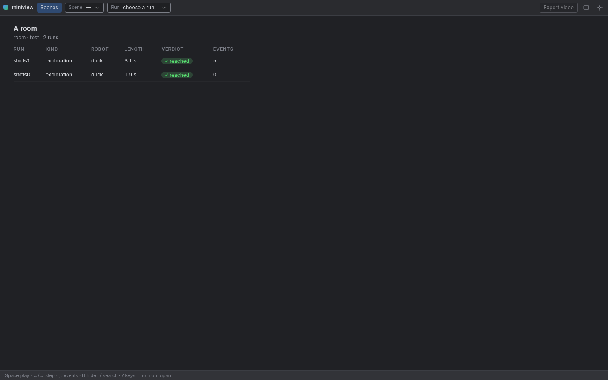
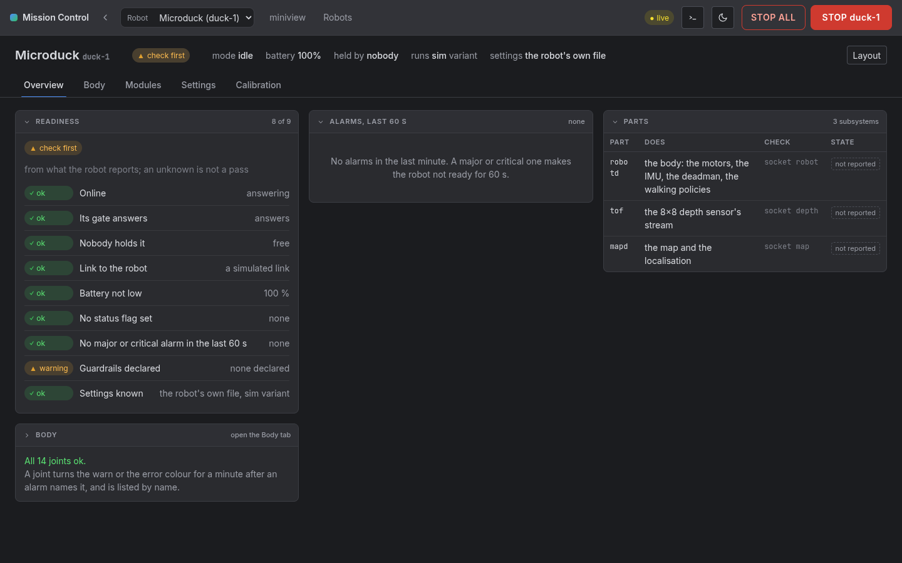
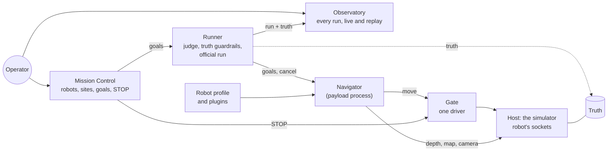

# robotics-lab

A simulator-first lab for robot autonomy. Any robot sits behind one interface; **Mission Control**
runs its missions, the **Observatory** records and replays every run, a challenge course judges its
navigation on frozen scenarios against the simulator's truth, and learned controllers are trained
and evaluated against the rules they would replace. The real robot comes last, after the simulator.

[](docs/index.md)

Docs site: **<https://chipi.github.io/robotics-lab/>**

## What is in it

- **Operate:** Mission Control (`apps/mission-control`) holds robots, readiness, sites and areas,
  goals, and a STOP that always works, behind one API; each robot plugs in through an adapter.
- **Record and watch:** the Observatory (`apps/observatory`, once called miniview) keeps every run
  as an MCAP file, live and replayed, with the robot's belief against the truth, its map, its plan
  and its alarms.
- **Test:** a challenge course (28 numbered challenges,
  [RFC-0008](docs/rfc/RFC-0008-challenge-course.md)) scores a navigator by the simulator's truth,
  one difficulty at a time, and frozen scenario sets compare one navigator with another.
- **Learn:** learned local controllers, trained on a GPU box in the public
  [chipi/microduck-nav](https://github.com/chipi/microduck-nav) and judged against the rules on
  those sets ([the guide](docs/training/index.md)).
- **Robots:** each is a profile and plugins behind the same interface, simulator first; which ones
  are wired today is in [Projects](#projects).

| Observatory: every run | Mission Control: the robot page |
| --- | --- |
|  |  |

The screenshots come from a fixture run and the fake robot (`make screenshots`); no simulator and no
robot were running.

## Quick start

You need [uv](https://docs.astral.sh/uv/) and `make`. Docker is needed only for the `*-up` targets.
Several defaults in the Makefile are the author's workstation paths (`/work/robotics-lab/...`), so
name your own folders as below.

```bash
make help                 # every target, one line each
make ci-fast              # lint and every project's unit tests: no simulator, no robot
make docs-serve           # this documentation at http://127.0.0.1:8765

# Mission Control with the fake robot, no Docker: http://127.0.0.1:8060/
make control-run CONTROL_STATE=$HOME/.local/state/robotics-lab/control

# The Observatory on a folder of runs (in Docker): http://127.0.0.1:8070/
make observatory-up OBSERVATORY_DATA=$HOME/robotics-lab/data \
  OBSERVATORY_STATE=$HOME/.local/state/robotics-lab/observatory

# The NXT web UI with a simulated brick (no robot): http://127.0.0.1:8000/
make nxt-web-fake

make screenshots          # retake the pictures above
```

The Observatory has no runs until something records one: a run opens from a folder in format 2
([the contract](apps/observatory/CONTRACT.md)). The fixture run the screenshots use is built in
`scripts/look_shots.py`.

**The simulated duck** needs Pollen's simulator on the machine, which is not in this repository: set
the machine up with `scripts/host-setup`, check it with `scripts/host-check`, and name the checkouts
in a host file (`simhost init`; [RFC-0021](docs/rfc/RFC-0021-sim-host-and-payload.md)). Then
`lab-challenge`, `lab-explore`, `lab-go` and `make sim-duck` run on it. They reset the simulator and
are not part of CI.

## How it fits together

**The rule:** the navigator sees only what a real robot would give it (its sensors, its motors, its
map). The simulator's truth (where the robot really is) is the runner's alone: for judging, for the
safety guardrails, for the recording. Every path keeps it so: a challenge, an exploration, a goal
from Mission Control (RFC-0021 step 6, checked while each run goes).



| Piece | Knows | Never knows |
| --- | --- | --- |
| Robot profile and plugins ([RFC-0020](docs/rfc/RFC-0020-robot-profiles-and-plugins.md)) | the robot | any machine, any run |
| Host, a simulator kind ([RFC-0021](docs/rfc/RFC-0021-sim-host-and-payload.md), `libs/simhost`) | the machine and its simulator | any navigator |
| Navigator, the payload | the robot's sockets and profile | the truth, the host file |
| Runner | the host, the truth, the course's rules | how the navigator thinks |
| Gate ([RFC-0017](docs/rfc/RFC-0017-robot-access.md)) | who holds the robot | what they do with it |
| Run format and Observatory | runs | robots, hosts |
| Mission Control ([RFC-0014](docs/rfc/RFC-0014-mission-control.md)) | robots, through their adapters | the truth, how a navigator works |

The whole map, with how a goal flows on each path and where every seam is:
[How the platform fits together](docs/architecture.md). The runner is a library of its own
(`libs/runner`, `lab-*` commands) that finds a robot by name and never imports it:
[RFC-0022](docs/rfc/RFC-0022-platform-layout-and-names.md).

## Projects

Three kinds of folder (RFC-0018). Every project is its own uv project with its own `.venv` and
`uv.lock`; the libraries are path sources.

| Path | What |
| --- | --- |
| [apps/observatory/](apps/observatory/) | The Observatory (once called miniview): runs as MCAP, an API with live runs, the workbench pages (`make observatory-up`; [CONTRACT.md](apps/observatory/CONTRACT.md)) |
| [apps/mission-control/](apps/mission-control/) | Mission Control (RFC-0014): robots, goals, sites and areas behind one API; adapters for a fake robot, the simulated duck (behind `lab-gate` and `lab-nav-server`) and the NXT (`make test-control`, `make control-run`, `make sim-duck`; [CONTRACT.md](apps/mission-control/CONTRACT.md)) |
| [apps/nxt-web/](apps/nxt-web/) | LEGO Mindstorms NXT 2.0 driven from our own Python code: web UI, NXC programs |
| [libs/simhost/](libs/simhost/) | The simulator host (RFC-0021): the host file (`simhost init`, `show`, `reset`, `down`), the reset, the truth sampler; standard library only. A machine is set up for it by `scripts/host-setup` and checked by `scripts/host-check` |
| [libs/runner/](libs/runner/) | The runner (RFC-0021, RFC-0022), `labrunner`: starts a robot's navigator as a payload, judges it by the truth, writes the official run; the course and its judge, the scores, the simulated camera, the gate proxy; `lab-challenge`, `lab-eval`, `lab-explore`, `lab-go`, `lab-nav-server`, `lab-gate`, `lab-scenarios` (scenario sets for the eval repository: `export`, and `mine`, which turns failed runs into scenarios) (`--robot duck`; the old `duck-*` names work for one release) |
| [libs/runfile/](libs/runfile/) | The run format: schemas, writer and reader, keys, the truth copy, the importers of a robot's log, the catalog |
| [libs/gate/](libs/gate/) | The robot gate (RFC-0017), `robotgate`: one driver per robot |
| [libs/missions/](libs/missions/) | Mission planning (RFC-0030), `missions`: the goal schemas, the guardrail vocabulary and its merge, the planner; data in, data out, no robot; standard library only |
| [libs/worldmodel/](libs/worldmodel/) | Objects, the semantic map and sites, which know no robot |
| [libs/web/](libs/web/) | The web library both apps share (RFC-0024): the design tokens and fonts, the three.js stage, the palette, layouts, time, evidence links; plain ES modules, served at `/lib/` (`make test-web`) |
| [scenes/](scenes/) | The scenes, one folder each with a `scene.json` (bounds, rooms, hazards, boxes), versioned here and read by `libs/runfile` (the scene file, PHASE5-NEXT-PLAN item 2); `scenes/apartment` |
| [dashboards/](dashboards/) | The Grafana dashboard for the telemetry (`robotics-lab-live.json`; `make grafana-dry`, `make grafana-import`; [TELEMETRY](docs/wip/TELEMETRY.md)) |
| [nav2/](nav2/) | A Nav2 container for comparing against the duck's navigator (RFC-0015, ADR-0018): a learning tool, nothing of ours depends on it |
| [robots/duck/](robots/duck/) | Pollen's Microduck: its profile and plugins, its navigator (a payload), its simulator scenes and probes, its tools (`duck-replay`, `duck-site`, `duck-pic` ...); registered for the runner as `duck` |
| [robots/](robots/) | Each robot's description and meshes (RFC-0011): the duck, the EV3s, the NXT Shooterbot |

Which package may import which is checked by `scripts/check_boundaries.py` (run by `make lint`);
the table is in [RFC-0018 §10](docs/rfc/RFC-0018-lab-projects-and-seams.md).

Beside this repository:

| Repository | What |
| --- | --- |
| [chipi/microduck-nav](https://github.com/chipi/microduck-nav) (public) | NVIDIA's obstacle-avoidance task ported to mjlab against Pollen's walker: the training code, its tasks and its tests. This repository's navigator loads what it trains through a local-controller slot (`robots/duck/src/duck_lab/plugins/learned.py`) |
| A private eval repository | The datasets of frozen scenarios (exported by `lab-scenarios`), the evaluation runs and their pre-registered comparison, built on eval-harness |

## Status

- **MVP 1: built.** The platform, both apps and their shared web library, the simulated duck behind
  Mission Control, the NXT's simulator behind it too, a staging stack deployed on the lab's server
  (the fake robot only), and telemetry into the lab's dashboards. The look-and-feel review closed
  on 2026-11-26. What is left of it: this close-out (docs, name and branding), the NXT at the
  brick, and the staging cut-over to a real robot, which wait on hardware and a maintenance
  window ([the handover](docs/wip/HANDOVER.md)).
- **The learning arc, now, before MVP 2.** The duck's learned local controller: a first training
  run (M1) passed, two longer ones (M2a, M2b) are trained, and our rules are the baseline on the
  frozen sets (30 of 30 on `avoidance_v1`, 23 of 40 on the harder `avoidance_v2`, no collisions).
  Next are the learned checkpoints against that baseline, then our own training variants
  ([the learning arc's handover](docs/wip/HANDOVER-TRAINING-2026-11-26.md),
  [RFC-0031](docs/rfc/RFC-0031-learning-in-the-lab.md)). The real duck arrives later.
- **MVP 2: next, not started.** A TurtleBot3 Burger on ROS 2 Jazzy and Gazebo Harmonic. A one-day
  spike ran the simulator headless and mapped a room with SLAM Toolbox
  ([the spike](docs/wip/MVP2-SPIKE.md)); the design is
  [RFC-0025](docs/rfc/RFC-0025-mvp1-to-mvp2.md).

## Checks and CI

The same make targets run on the workstation and in CI ([`.github/workflows/ci.yml`](.github/workflows/ci.yml)),
so a red job reproduces locally with the target it names:

| Target | What |
| --- | --- |
| `make ci-fast` | lint (compile, workflows, package boundaries), then `test-sim-lock`, `test-deploy`, `test-libs`, `test-web` and every project's unit tests: `test-unit` (nxt), `test-duck`, `test-observatory`, `test-control` |
| `make test-libs` | each library's own tests, each in its own environment (`libs/runfile`, `simhost`, `gate`, `missions`, `runner`) |
| `make test-web` | the shared web library: one token file, one three.js (standard library only) |
| `make test-deploy` | `scripts/deploy.py`'s self-test: a named commit's files, the overlay, the record and the rollback (no Docker) |
| `make test-sim-lock` | `scripts/sim-lock`'s self-test: waits for a holder, gives up after its timeout (no simulator) |
| `make test-control-page` | Mission Control's page in headless Chromium at phone and desktop width, light and dark |
| `make test-observatory-pages` | the Observatory's two pages in headless Chromium (`OBSERVATORY_CHROMIUM`, else Playwright's) |
| `make test-integration` | the NXT web UI image (built from the repo root) answers with a simulated brick and records an Observatory run |
| `make test-observatory-image` | the Observatory's image runs with the data mounted read only and its index on its own volume, serves a run, and cannot write the data |
| `make test-run-compat` | a run opens fully in Rerun (`mcap check`, `mcap convert`), in the Observatory, and in Lichtblick (its image, headless) when `COMPAT_LICHTBLICK=1`; guards ADR-0007's compatibility |
| `make perf-observatory` | not in CI: replays a real run at 20 Hz through the writer with both pages open and prints latency, bytes per page and lock hold time |
| `make nxt-programs` | every NXC program compiles for the brick |
| `make ci` | all of the above and the docs (`docs-lint`, `docs-build`) |

The names before the rename still work for one release: the `miniview` command, `make viewer-up`,
`make viewer-down`, `make test-viewer`, and the `MINIVIEW_*` variables where an `OBSERVATORY_*` one
is not set.

## Docs

The docs site is **<https://chipi.github.io/robotics-lab/>**, built from [`docs/`](docs/index.md)
with MkDocs Material; `make docs-serve` reads it locally and `make docs-validate` (Markdown lint and
the strict build) runs before every push.

- [User guides](docs/guides/index.md): Mission Control, the Observatory, the NXT web app, the
  command line.
- [How the platform fits together](docs/architecture.md), the map.
- [The handover](docs/wip/HANDOVER.md), the living status, and
  [the phase 5 plan](docs/wip/PHASE5-NEXT-PLAN.md).
- [Training the controller](docs/training/index.md), a guide to the learned controller from first
  principles.
- [Proposals (RFC)](docs/rfc/README.md), [decisions (ADR)](docs/adr/README.md),
  [in progress](docs/wip/README.md) and [history](docs/history/README.md).

## Licence

[MIT](LICENSE). One file is vendored with its own terms: `libs/runfile/src/runfile/schemas/LICENSE-foxglove-schemas.txt`
(Foxglove's schemas).
