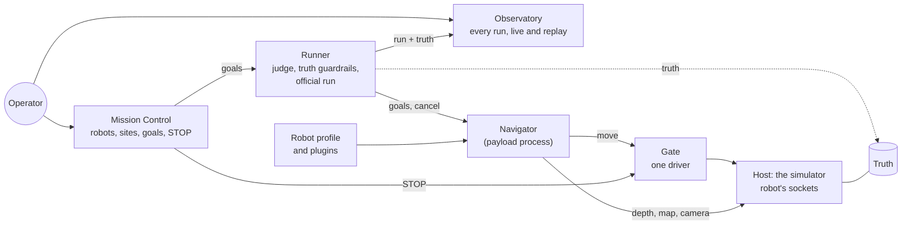

# robotics-lab

A robot platform where any robot can be loaded: a robot brings what it is (a profile and plugins),
a simulator brings what it provides (a host), a navigator is tested behind a runner that judges it
by the simulator's truth, every run is recorded one way and watched in one viewer (the
Observatory), and the operator drives it all from one control panel (Mission Control). Built on
Pollen's Microduck in simulation first; the LEGO NXT and EV3s and a TurtleBot3 are next.

## How it fits together

**The rule:** the navigator sees only what a real robot would give it (its sensors, its motors, its
map). The simulator's truth (where the robot really is) is the runner's alone: for judging, for the
safety guardrails, for the recording. Every path keeps it so: a challenge, an exploration, a goal
from Mission Control (RFC-0021 step 6, checked while each run goes).

| Piece | Knows | Never knows |
| --- | --- | --- |
| Robot profile and plugins ([RFC-0020](docs/rfc/RFC-0020-robot-profiles-and-plugins.md)) | the robot | any machine, any run |
| Host, a simulator kind ([RFC-0021](docs/rfc/RFC-0021-sim-host-and-payload.md), `libs/simhost`) | the machine and its simulator | any navigator |
| Navigator, the payload | the robot's sockets and profile | the truth, the host file |
| Runner | the host, the truth, the course's rules | how the navigator thinks |
| Gate ([RFC-0017](docs/rfc/RFC-0017-robot-access.md)) | who holds the robot | what they do with it |
| Run format and Observatory | runs | robots, hosts |
| Mission Control ([RFC-0014](docs/rfc/RFC-0014-mission-control.md)) | robots, through their adapters | the truth, how a navigator works |

The whole map, with how a goal flows on each path and where every seam is:
[How the platform fits together](docs/architecture.md). Where the platform's pieces should live
and what they should be called, now that they are not only the duck's:
[RFC-0022](docs/rfc/RFC-0022-platform-layout-and-names.md) (proposed).

## Projects

Three kinds of folder (RFC-0018). Every project is its own uv project with its own `.venv` and
`uv.lock`; the libraries are path sources.

| Path | What |
| --- | --- |
| [apps/observatory/](apps/observatory/) | The Observatory (once miniview): runs as MCAP, an API with live runs, the workbench pages (`make observatory-up`; [CONTRACT.md](apps/observatory/CONTRACT.md)) |
| [apps/mission-control/](apps/mission-control/) | Mission Control (RFC-0014): robots, goals, sites and areas behind one API; adapters for a fake robot, the simulated duck (behind `duck-gate` and `duck-nav-server`) and the NXT (`make test-control`, `make control-run`, `make sim-duck`; [CONTRACT.md](apps/mission-control/CONTRACT.md)) |
| [apps/nxt-web/](apps/nxt-web/) | LEGO Mindstorms NXT 2.0 driven from our own Python code: web UI, NXC programs |
| [libs/simhost/](libs/simhost/) | The simulator host (RFC-0021): the host file (`simhost init`, `show`, `reset`, `down`), the reset, the truth sampler; standard library only. A machine is set up for it by `scripts/host-setup` and checked by `scripts/host-check` |
| [libs/runfile/](libs/runfile/) | The run format: schemas, writer and reader, keys, the truth copy, the importers of a robot's log, the catalog |
| [libs/gate/](libs/gate/) | The robot gate (RFC-0017), `robotgate`: one driver per robot |
| [libs/worldmodel/](libs/worldmodel/) | Objects, the semantic map and sites, which know no robot |
| [robots/duck/](robots/duck/) | Pollen's Microduck: its profile and plugins, its navigator (a payload), its simulator scenes and probes, and for now the platform's runner, judge and course (RFC-0022 proposes moving them out) |
| [robots/](robots/) | Each robot's description and meshes (RFC-0011): the duck, the EV3s, the NXT Shooterbot |

Which package may import which is checked by `scripts/check_boundaries.py` (run by `make lint`);
the table is in [RFC-0018 §10](docs/rfc/RFC-0018-lab-projects-and-seams.md).

## Checks and CI

The same make targets run on the workstation and in CI ([`.github/workflows/ci.yml`](.github/workflows/ci.yml)),
so a red job reproduces locally with the target it names:

| Target | What |
| --- | --- |
| `make ci-fast` | lint (compile, workflows, package boundaries), then every project's unit tests: `test-unit` (nxt), `test-duck`, `test-observatory`, `test-control` |
| `make test-observatory-pages` | the Observatory's two pages in headless Chromium (`OBSERVATORY_CHROMIUM`, else Playwright's) |
| `make test-integration` | the NXT web UI image (built from the repo root) answers with a simulated brick and records an Observatory run |
| `make test-observatory-image` | the Observatory's image runs with the data mounted read only and its index on its own volume, serves a run, and cannot write the data |
| `make test-run-compat` | a run opens fully in Rerun (`mcap check`, `mcap convert`), in Lichtblick (its image, headless: topics, start date, the topics draw) and in the Observatory; guards ADR-0007's compatibility |
| `make perf-observatory` | not in CI: replays a real run at 20 Hz through the writer with both pages open and prints latency, bytes per page and lock hold time |
| `make nxt-programs` | every NXC program compiles for the brick |
| `make ci` | all of the above and the docs (`docs-lint`, `docs-build`) |

The names before the rename still work for one release: the `miniview` command, `make viewer-up`,
`make viewer-down`, `make test-viewer`, and the `MINIVIEW_*` variables where an `OBSERVATORY_*` one
is not set.

## Docs

The docs site lives in [`docs/`](docs/index.md) (MkDocs Material, same conventions as the
operator's other projects): `make docs-serve` to read it, `make docs-validate` before pushing.

- Start with [status and open decisions](docs/wip/STATUS.md).
- [Proposals (RFC)](docs/rfc/README.md): the NXT web UI, the robot brain, one robot interface,
  perception and planning, missions with flotilla and eval-harness.
- [In progress](docs/wip/README.md): ideas, Microduck notes, parts list.
- [History](docs/history/README.md).
