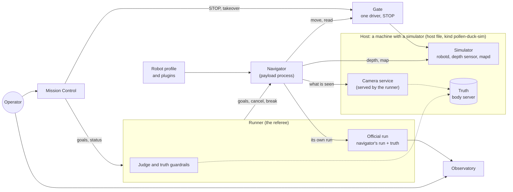
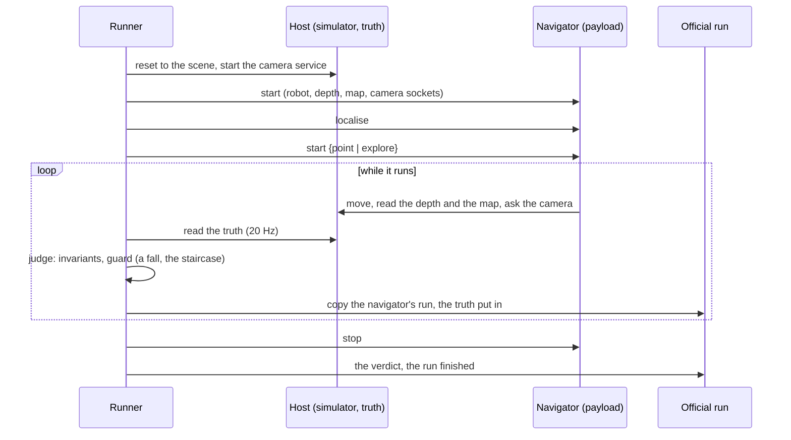
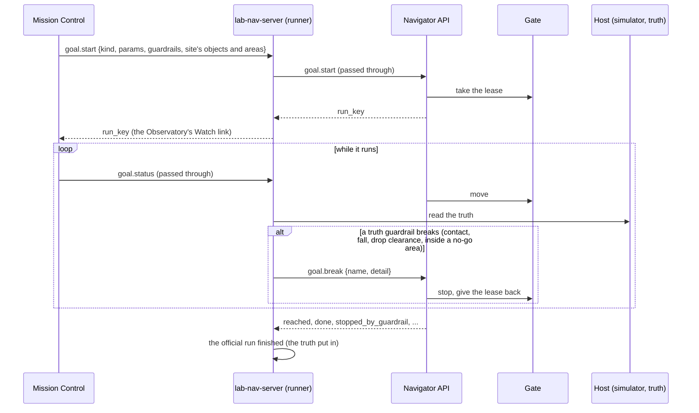

# How the platform fits together

The goal (the operator, 2026-11-19): **a robot platform where we can load any robot.** A robot
brings what it is; a simulator brings what it provides; the navigator is the part under test; the
runner judges it; every run is recorded one way and viewed one way; the operator drives it all from
one place. This page is the map: the pieces, what each knows, how a goal flows through them, and
where each one lives today. The decisions behind it are in the RFCs and ADRs it links.

## The rule everything follows

**The navigator sees only what a real robot would give it.** In a simulator the truth (where the
robot really is) is known, and it is tempting to use it; but a navigator that reads it is not being
tested, a real robot has none, and in an arena it would be cheating. So the truth is the runner's
alone: for judging, for the safety guardrails a real robot would report itself, and for the
recording. The navigator gets the robot's connections (its sensors, its motors, its map) and a goal.

Since RFC-0021 step 6 (2026-11-21) every path keeps this rule: a course, an exploration, and
Mission Control. The navigator's process is checked while it runs: it held no connection to the
truth's port in any run since (583 checks in the proof batch, 150 in an exploration, 282 over
`make sim-duck`'s 15 goals).

## The pieces

| Piece | Its job | Knows | Never knows | Where | Its contract |
| --- | --- | --- | --- | --- | --- |
| **Robot profile and plugins** | What a robot is: its size, speeds, sensors, error budget; how to walk it, read its ranges, localise it, turn its head | The robot | Any machine, any run | `robots/duck/profile.json`, `duck_lab/plugins/` | [RFC-0020](rfc/RFC-0020-robot-profiles-and-plugins.md) |
| **Host** (a simulator kind) | A machine that runs a simulator: the robot's sockets, a reset, the truth, the scenes, the simulated camera | The machine and its simulator | Any navigator | `libs/simhost` (the host file), `libs/runner` (`labrunner.camera`: the simulated camera it serves) | [RFC-0021 §3](rfc/RFC-0021-sim-host-and-payload.md) |
| **Navigator** (the payload) | The brain: localise, plan, walk to a goal, explore, recognise objects | The robot's sockets and profile | The truth, the host file | `duck_lab/nav/`, `duck_lab/payload.py`, `duck_lab/nav/server.py` | the payload contract (`duck_lab/payload.py`); the navigator API ([Mission Control's contract](https://github.com/chipi/robotics-lab/blob/main/apps/mission-control/CONTRACT.md)) |
| **Runner** | The referee: starts the navigator, gives it goals, reads the truth, judges, stops it when a guardrail breaks, writes the official run | The host, the truth, the course's rules | How the navigator thinks | `libs/runner` (`labrunner`): `lab-challenge`, `lab-eval`, `lab-explore`, `lab-go`, `lab-nav-server` (in front of Mission Control) | [RFC-0021 step 2 and 6](rfc/RFC-0021-sim-host-and-payload.md), [RFC-0008](rfc/RFC-0008-challenge-course.md) |
| **Gate** | The one lock in front of a robot: one driver at a time, a STOP that always works, takeover by name | Who holds the robot | What they do with it | `libs/gate` (`robotgate`, the rules), `libs/runner` (`lab-gate`, the proxy) | [RFC-0017](rfc/RFC-0017-robot-access.md) |
| **Run format and the Observatory** | Every run recorded one way (format 2, MCAP); the viewer and its API, live and replay | Runs | Robots, hosts | `libs/runfile`, `apps/observatory` | [ADR-0007](adr/ADR-0007-run-file-format-2.md), [the Observatory's contract](https://github.com/chipi/robotics-lab/blob/main/apps/observatory/CONTRACT.md) |
| **World model** | Objects, the semantic map, sites and their areas, for any robot | Places and things | Robots | `libs/worldmodel` | [RFC-0016](rfc/RFC-0016-objects-and-semantic-map.md) |
| **Mission Control** | The operator's control panel: robots, sites, goals, live status, STOP | Robots through their adapters | How a navigator works, the truth | `apps/mission-control` | [RFC-0014](rfc/RFC-0014-mission-control.md) |

Which package may import which is checked on every `make lint` (`scripts/check_boundaries.py`, the
table in [RFC-0018 §10](rfc/RFC-0018-lab-projects-and-seams.md)): the navigator (`duck_lab.nav`, the
payload, the plugins, the profile) may import neither the runner (`labrunner`) nor the host library;
the runner has no import of a robot's package, it finds a robot by name: a registration file the
installation names (`robots.<name>.registration`, a JSON file with the robot's name, profile and
commands; phase 5 step 1), else the entry-point group `robotics_lab.robots`
([RFC-0022](rfc/RFC-0022-platform-layout-and-names.md)), which loads the robot's small registration
module when the runner starts (the check cannot see that, by design). The navigator may not import
`runfile.installation` or `runfile.registry`: it gets everything as arguments;
and a test checks that importing the payload or the navigator API loads neither.

## The whole picture

Dotted lines read the truth; only the runner's pieces have them.

## How a goal flows

### A course: a challenge, the phase 1 evaluation, an exploration

`lab-challenge`, `lab-eval`, `lab-explore` and `lab-go` are runners (`--robot duck`). Each starts
the navigator as a payload process with only the robot's sockets (and the camera's, for objects)
and drives it over the payload contract; `lab-challenge` and `lab-eval` reset the host for each
goal first (`lab-explore` starts where the robot stands: reset it before,
`robots/duck/sim/reset_sim.py`):

### Mission Control

The operator starts `lab-gate` and `lab-nav-server`, and Mission Control talks to
`lab-nav-server` as its robot's navigator. `lab-nav-server` is the runner; the navigator API
behind it is its own process:

The guardrails that need no truth stay the navigator's: the speed cap, the no-go area in its
planner, the time limit, stuck. STOP never goes through the navigator: Mission Control sends it to
the gate.

### The real robot (designed, not run: there is no real duck yet)

A real robot has no truth. The intended path: the robot's forwarded sockets named per machine,
the runner working without the truth (no sampler, no truth guardrails, the official run copied
without it), and the guardrails that need the truth the robot's own to report; the navigator is the
same code with the profile's `real` variant. **Not buildable today:** the host file cannot be
written for a machine without Pollen's simulator (`simhost/host.py` requires its checkouts), and
the runner refuses a host with no truth port; Mission Control would have to talk to the navigator
API directly, a path with no test (the
[architecture review of 2026-11-22](wip/ARCHITECTURE-REVIEW-2026-11-22.md); phase 5 builds the
runner without the truth and the installation file).

## The seams (where something else can be plugged in)

| Seam | What can change behind it | Defined in |
| --- | --- | --- |
| The robot profile and its four plugins (locomotion, range sensing, localisation, looking) | another robot | [RFC-0020](rfc/RFC-0020-robot-profiles-and-plugins.md) |
| A simulator kind (reset, connections, truth reader, scene writer) | another simulator: Gazebo with the TurtleBot3 is planned | [RFC-0021 §3.1](rfc/RFC-0021-sim-host-and-payload.md) |
| The host file | another machine (the workstation, the MacBook, a clean container) | [RFC-0021 §3](rfc/RFC-0021-sim-host-and-payload.md) |
| The payload contract (hello, localise, start, status, cancel, stop) | another navigator: `robots/duck/payloads/straight.py` is a second one | `duck_lab/payload.py` |
| The navigator API | another robot's navigator, behind Mission Control | [Mission Control's contract](https://github.com/chipi/robotics-lab/blob/main/apps/mission-control/CONTRACT.md) |
| Mission Control's adapters (`fake`, `duck-sim`, `nxt-web`) | another robot in the control panel | [RFC-0014](rfc/RFC-0014-mission-control.md) |
| The gate's protocol | another robot's lock | [RFC-0017](rfc/RFC-0017-robot-access.md) |
| The run format | another recorder; the Observatory reads only the format | [ADR-0007](adr/ADR-0007-run-file-format-2.md) |
| The camera socket (Detections relative to the robot) | a real camera's detector (designed: none exists yet, and the camera service needs the simulator's truth) | RFC-0021 step 6 |

## Not yet generic

- **Only one robot has run on it.** The navigator takes its numbers from the profile, but it has run
  only on the duck, and its plugins are the duck's (mapd's grid, the 8×8 depth sensor). It is
  generic when a second robot (the EV3 in phase 6, the TurtleBot3 after the plan) runs it.
- **Only one simulator kind exists** (`pollen-duck-sim`); the rule of §3.1 is tested when Gazebo
  is the second.
- **The runner reads its robot's numbers once, when it starts** (the judge's footprint and
  thresholds): with one robot registered that is it; a second robot needs its `--robot` read before
  the course's modules load ([RFC-0022](rfc/RFC-0022-platform-layout-and-names.md)).
- **The duck's operator tools and the apartment stay the duck's** (`duck-record`, `duck-replay`,
  `duck-world`, `duck-pic`, `duck-site`; the apartment's layout in `robots/duck/sim/`): they read
  the duck's own perception or the simulated apartment (RFC-0022 §8).
- **The real robot's path is designed, not run.**
