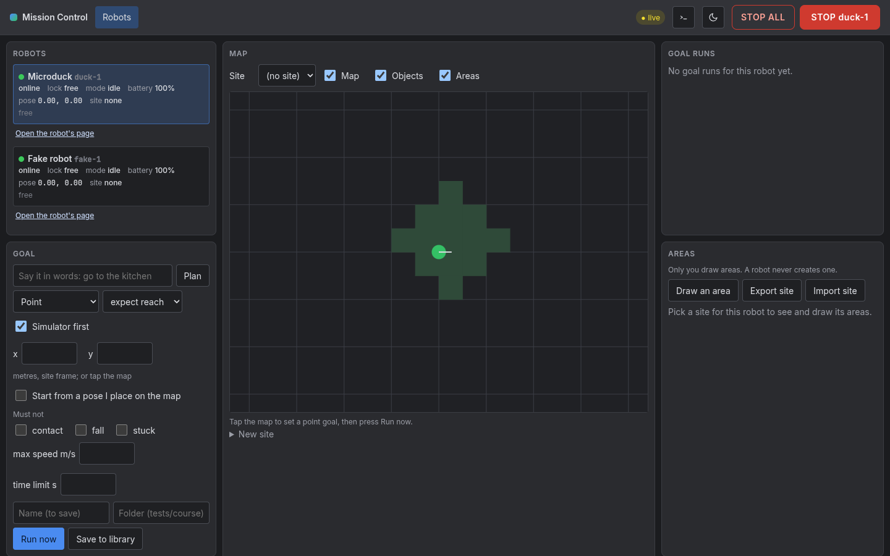
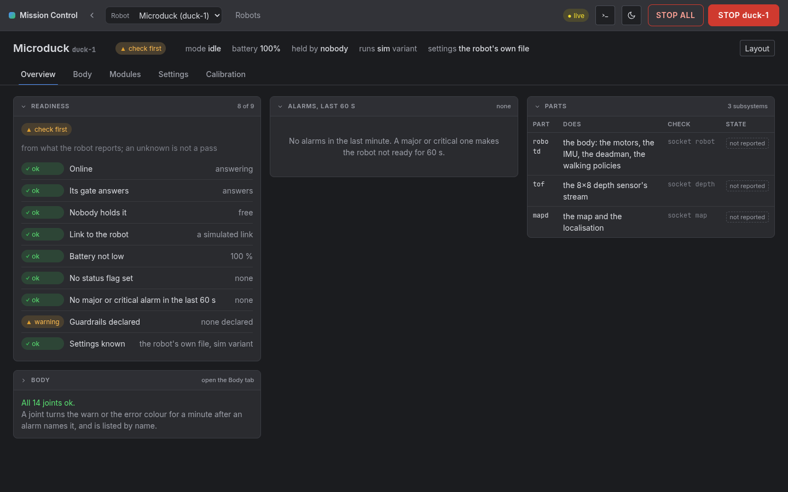
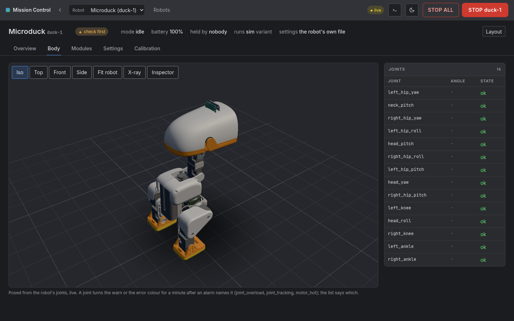
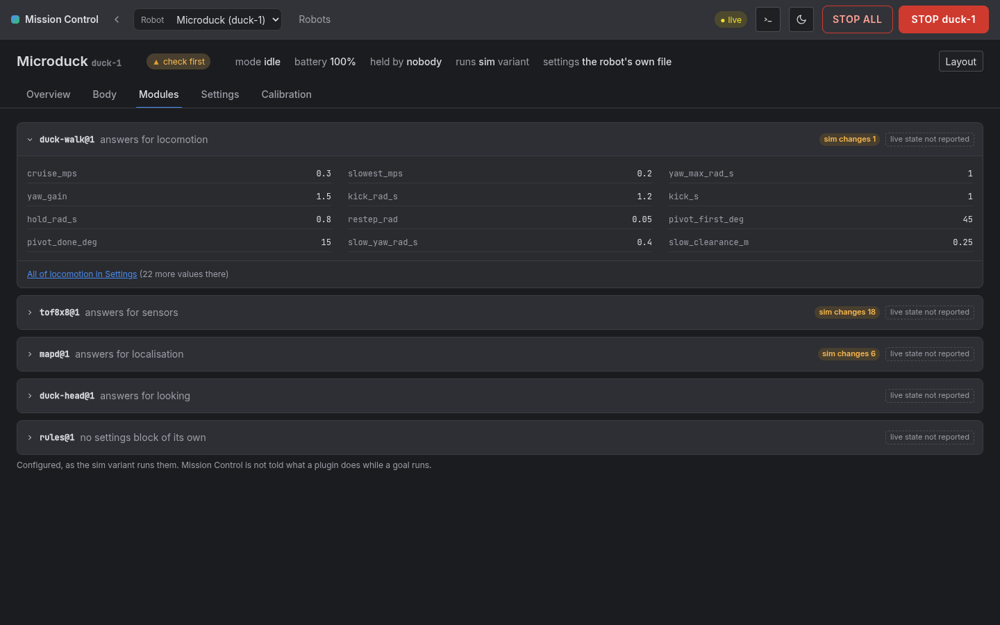
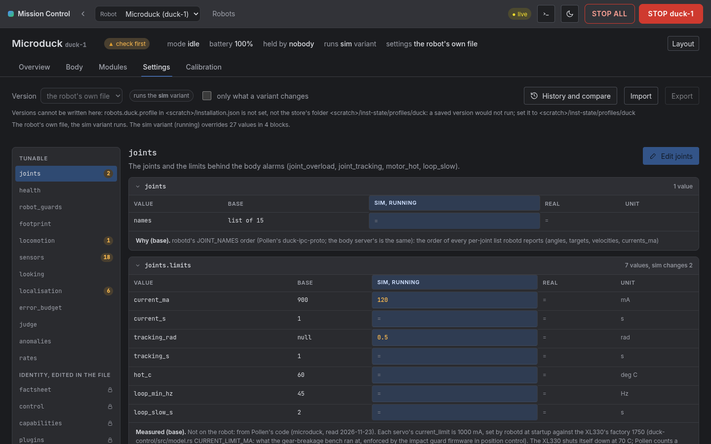
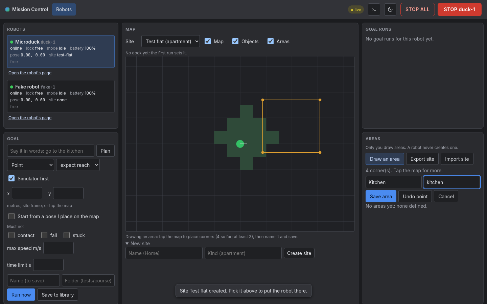
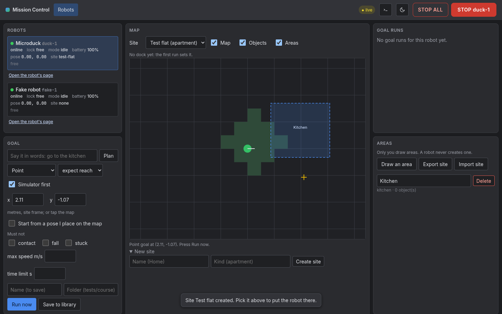
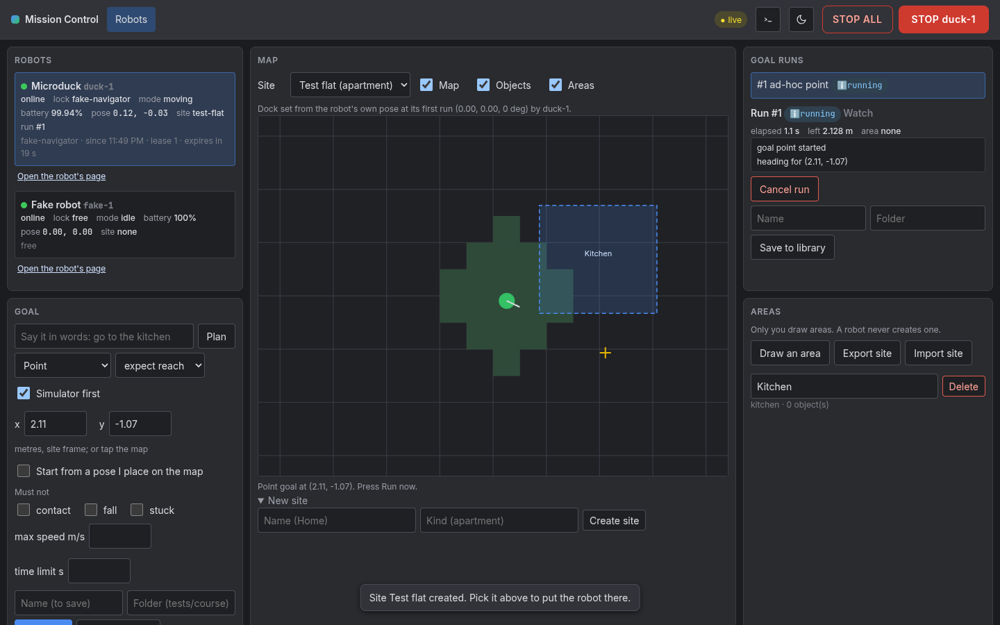
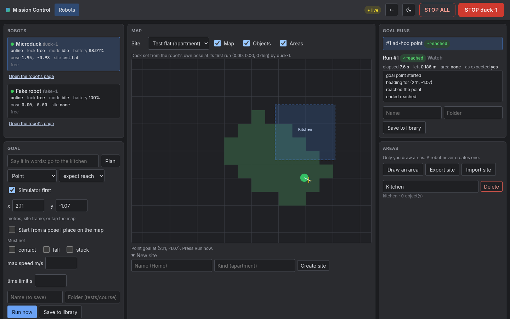
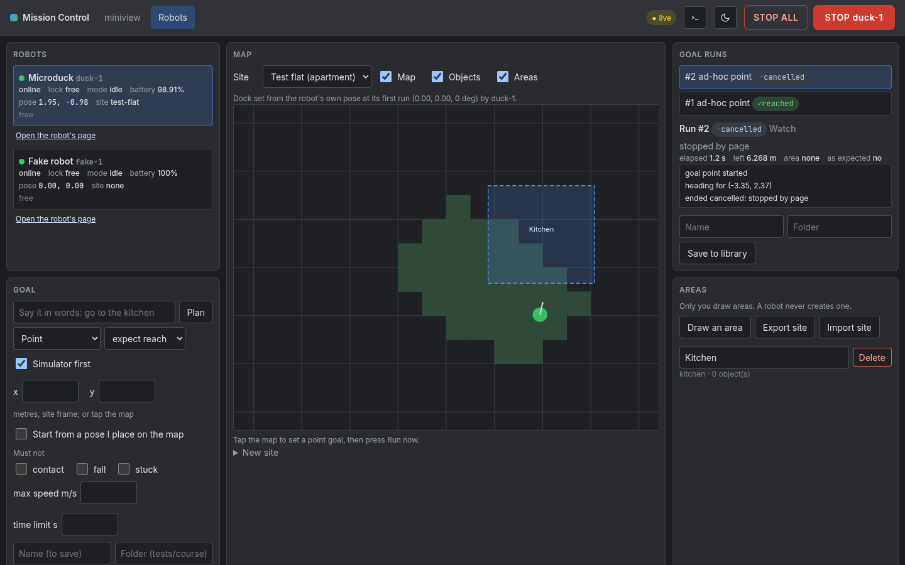

# Mission Control: see a robot's state, give it goals, stop it

**Provisional guide.** Written from the code and from running the steps below against the fake
robot, on scratch ports and a scratch state folder. It has not been checked on a real robot or the
simulator; see [Limits](#7-limits-of-this-provisional-guide).

## 1. Purpose

Mission Control (`apps/mission-control`) is the one place where you operate the lab's robots. It
shows each robot's state and whether it is fit to run, lets you describe a place and give the robot
a goal in it, shows the goal run as it happens, and carries the STOP button that always works. It
sits between you and a robot's own software: every robot speaks the same small API to it, so the
page and the commands look the same whichever robot is behind them
([RFC-0014](../rfc/RFC-0014-mission-control.md)).

It does not draw the replay of a run. That is the Observatory, which opens the run a goal left
behind ([the Observatory guide](observatory.md)).

## 2. Key use cases

- Check that a robot is ready before a run: online, nobody else holds it, battery, alarms, settings.
- Give it a goal: go to a point, go to an object or area, explore, take an inventory.
- Describe a place once: a site, with areas you draw on its map, reused by later goals.
- Watch a goal run: elapsed time, distance left, the decisions the robot took, its alarms.
- Stop one robot, or every robot, at any moment.
- Read and compare a robot's settings (its profile) and which software modules it runs.

## 3. Concepts

- **Robot:** one robot file in the robots folder, with an id (`duck-1`), a label and a kind.
  *Online* is measured: the robot answered recently. It is never a flag.
- **Profile:** the robot's settings (limits, locomotion, sensors, alarms' thresholds), kept as
  versions. A robot has a *variant* (`sim` or `real`) that overrides some values. Only robots whose
  file names a registered robot have one; the plain fake robot has none.
- **Readiness:** one verdict (`ready`, `check first`, `not ready`, `not known`) from named checks.
  An unknown check is not a pass, and the worst check decides.
- **Site and area:** a site is a place; a robot is at one site at a time. An area is a polygon you
  draw on the site's map and name ("Kitchen"). A robot never creates one.
- **Goal:** what you ask for (a *point*, *go to object*, *go to area*, *explore*, *inventory*), with
  optional "must not" guardrails (contact, fall, stuck), a speed limit and a time limit. *Expect
  reach/refuse* says which outcome you predict, and the run reports whether it matched.
- **Goal run:** one attempt at a goal. It ends `reached`, `cancelled`, `refused`, `stalled`,
  `timeout` and so on. A goal a robot cannot take is a run in the state `refused`, not an error.
- **Lease:** one driver holds a robot at a time. The page does not drive; a goal run holds the
  lease while it moves the robot, and an API client can take it.
- **STOP:** always accepted, needs no lease, ends the holder's lease and sends the robot a zero
  move. The reply says whether the robot *confirmed* it.

## 4. Start it

From the repo root. Use your own scratch state folder and a spare port; the default state folder
is the workstation's.

```sh
make control-run CONTROL_PORT=18160 CONTROL_STATE=$HOME/scratch/control-state
```

This serves `http://127.0.0.1:18160/` in the foreground with the fake robot only
(`apps/mission-control/robots.example`). There is no login; the tailnet is the authentication
([API contract](https://github.com/chipi/robotics-lab/blob/main/apps/mission-control/CONTRACT.md)).
Ctrl-C stops it. `make control-up` runs it in Docker instead.

The shots below use a second robot, a registered robot driven by the fake adapter, so the profile
pages have something to show. Put the files in a scratch folder:

```sh
mkdir -p $SCRATCH/robots $SCRATCH/state
cp apps/mission-control/robots.example/fake-1.json $SCRATCH/robots/
echo '{"id": "duck-1", "robot": "duck", "variant": "sim", "adapter": {"type": "fake"}}' > $SCRATCH/robots/duck-1.json
cat > $SCRATCH/installation.json <<EOF
{"installation": 1, "state": "$SCRATCH/state",
 "robots": {"duck": {"registration": "$PWD/robots/duck/registration.json", "variant": "sim"}}}
EOF
cd apps/mission-control
ROBOTICS_LAB_INSTALLATION=$SCRATCH/installation.json \
  uv run --frozen mission-control serve --robots $SCRATCH/robots --state $SCRATCH/state --port 18160
```

Run `make control-sync` once first. To have Mission Control and the Observatory on one address,
start the Observatory with `OBSERVATORY_CONTROL=http://127.0.0.1:18160` and open
`http://127.0.0.1:<observatory port>/control/` ([Observatory guide](observatory.md#4-start-it)).

## 5. Walkthrough (fake robot)

The shots come from `make screenshots-guides GUIDE_APPS=mission-control`, which starts its own
Mission Control and Observatory on free ports.

1. **Open the page and read the robot list.** Each card shows online, lock holder, mode, battery,
   pose and site. The top bar has STOP ALL and the STOP of the selected robot at all times.
   Below the list are the Goal form, the Map, the Goal runs and the Areas.

    

2. **Open a robot's page** (the card's link, or `#robot/duck-1`). The Overview tab has
   *Readiness*: each named check with its value. The verdict here is `check first` because the
   fake declares no guardrails, and an unknown is not a pass. *Alarms, last 60 s* lists what the
   robot's software flagged; a major or critical alarm makes the robot not ready for 60 s.
   *Parts* lists the robot's subsystems; the fake reports no state for them.

    

3. **Body tab.** The robot drawn from its description, posed from its joints, with a joint list.
   Joints with a recent alarm change colour. This needs the robot's meshes on the machine
   (`make robots`); without them the Overview card says so and nothing is drawn.

    

4. **Modules tab.** The software modules the profile names (locomotion, sensors, localisation)
   with their configured values for the running variant. Mission Control is not told what a module
   does during a run, and the page says so ("live state not reported").

    

5. **Settings tab.** Every tunable block of the profile, with the base value, what the running
   variant changes and the real variant's value. Edit, save as the next version, go back to an
   older version, compare, export and import are here. Saving needs the installation file to name
   the version store; the notice at the top says so when it does not (as here, in this scratch
   setup, so nothing was saved).

    

6. **Create a site and draw an area.** Back on the overview: open *New site*, give a name and kind,
   Create site, then pick it in the Site list. *Draw an area*, tap three or more corners on the map,
   name it and Save area. The site's dock is set by the robot's first run.

    

7. **Set a goal.** Tap the map: the goal becomes a *Point* with that x and y (site frame, metres).
   The other kinds are in the Goal list; *Say it in words* + Plan proposes goals from text, which
   you read back and run (it needs an LLM planner configured, or a phrase the built-in matcher
   knows). Nothing runs until you press **Run now**. *Save to library* keeps the goal for later.

    

8. **Watch it.** Run now starts goal run #1. The robot is held by its navigator (lock, mode
   `moving`), the map fills in as it explores, and the Goal runs panel shows elapsed time, distance
   left, the area it is in, and a log of its decisions.

    

9. **See it end.** The run reaches the point: state `reached`, "as expected yes". *Save to
   library* turns the run's goal into a library entry. The *Watch* link opens the run in the
   Observatory, but the fake robot records no Observatory run, so here it is disabled
   ("no Observatory run key").

    

10. **Press STOP.** Start a second goal far away, then press **STOP duck-1** in the top bar
    (**STOP ALL** for every robot; Ctrl+K opens a palette whose first verbs are the same two). The
    robot stops, the lease ends, the toast says it was stopped (or that it could not be confirmed),
    and run #2 ends `cancelled`, "stopped by page", as expected no. *Cancel run* in the run's
    panel ends only the goal; STOP is the one that always works.

    

11. **See the run in the Observatory.** With the two apps on one address, the top bar gains an
    Observatory link and a goal run's *Watch* and each alarm's *Open in the Observatory at this
    moment* open the run at that time. This step was not run here: the fake robot writes no run, so
    there is nothing to open. The shared address itself was checked (the Observatory serves this
    page at `/control/`):

    

## 6. Where to go next

- [The Observatory guide](observatory.md): replay the run a goal leaves.
- [Architecture](../architecture.md), "Mission Control": how a goal flows.
- [RFC-0014](../rfc/RFC-0014-mission-control.md): the API, goals, sites and areas.
- [RFC-0017](../rfc/RFC-0017-robot-access.md): who may watch, who may drive, one driver at a time.
- [RFC-0024](../rfc/RFC-0024-one-platform.md): why the two apps share an origin and a look.
- [API contract](https://github.com/chipi/robotics-lab/blob/main/apps/mission-control/CONTRACT.md):
  every call, status code and event.

## 7. Limits of this provisional guide

- Every step ran against the **fake robot** (a point that moves) in headless Chromium. Nothing
  touched the simulator or a real robot, so the real navigator, the *Simulator first* rehearsal,
  real-robot refusals (`real_runs_not_allowed`) and real STOP timing are read, not run.
- Not run: the Calibration tab, saving or importing a profile version (the scratch setup has no
  version store), Export site and Import site, the LLM planner, access tokens
  (`--require-tokens`), the MCP server, the Docker image (`make control-up`), the phone layout and
  the light theme, and the Observatory links from a run (the fake records no run).
- The local controller (`rules@1`) has no settings block of its own, and the Modules tab says so;
  a run may pick another controller (`lab-challenge --local-controller`), which this page does not
  show.
- The numbers (battery, poses, durations) are the fake's and are invented.
- Screenshots are dark theme, 1440 wide.
