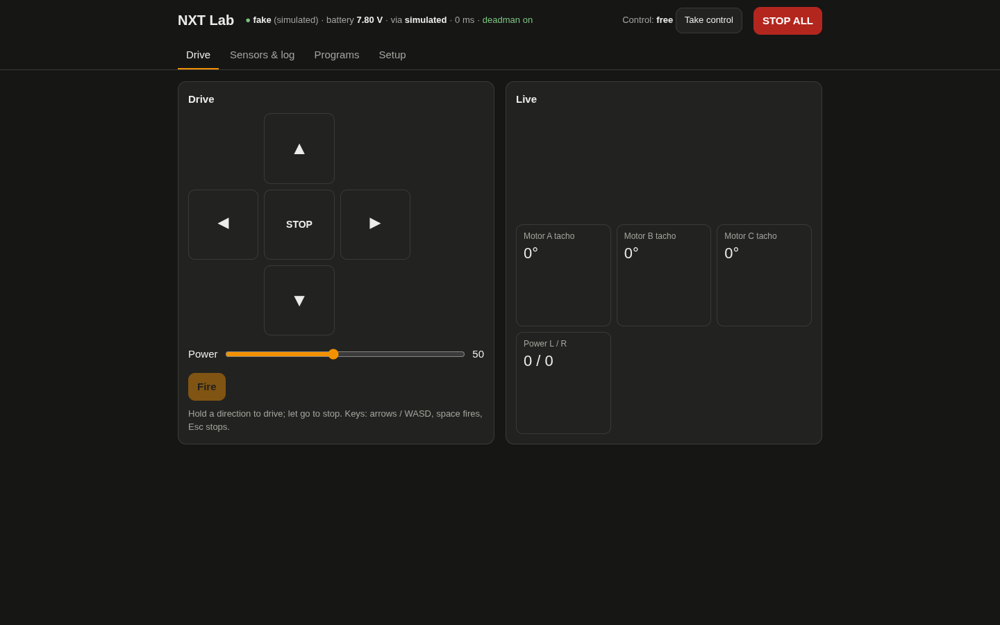
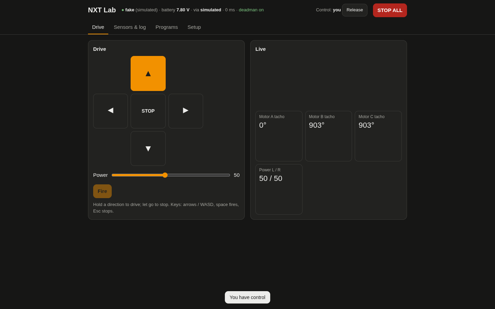
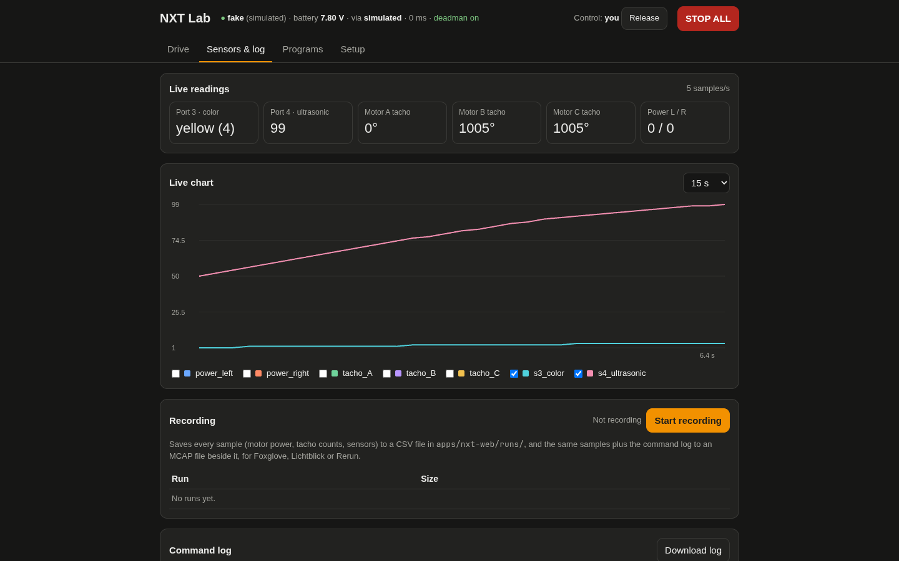
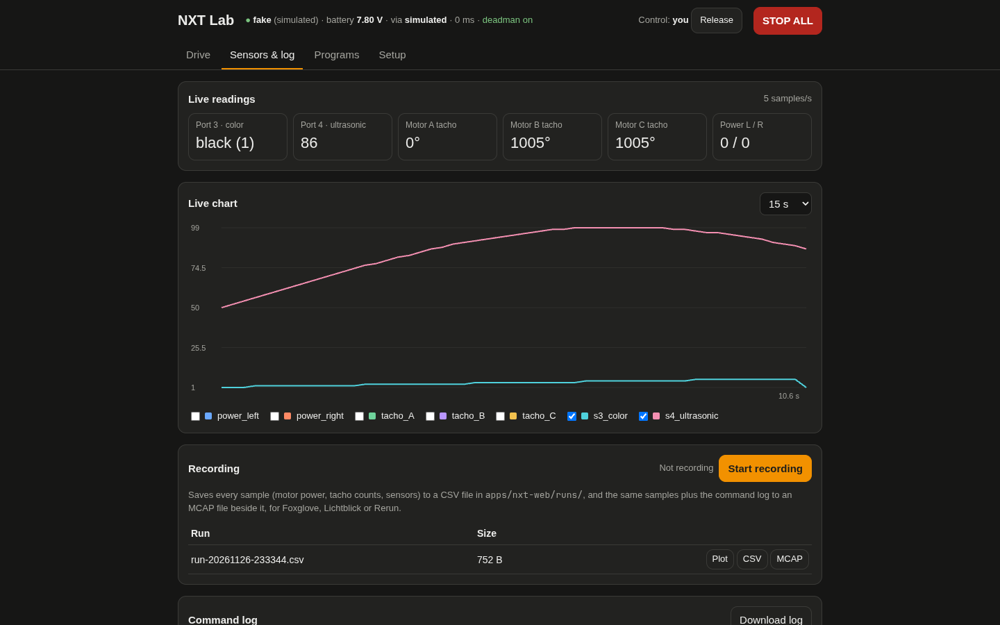
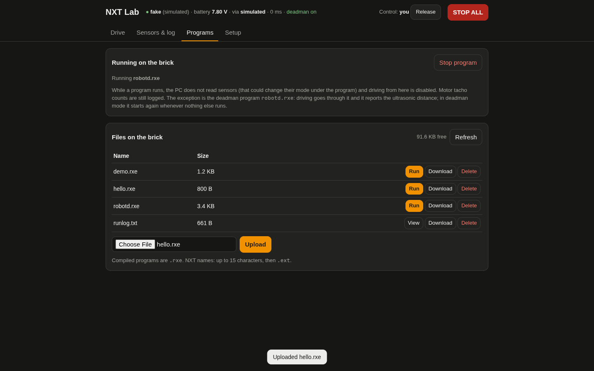
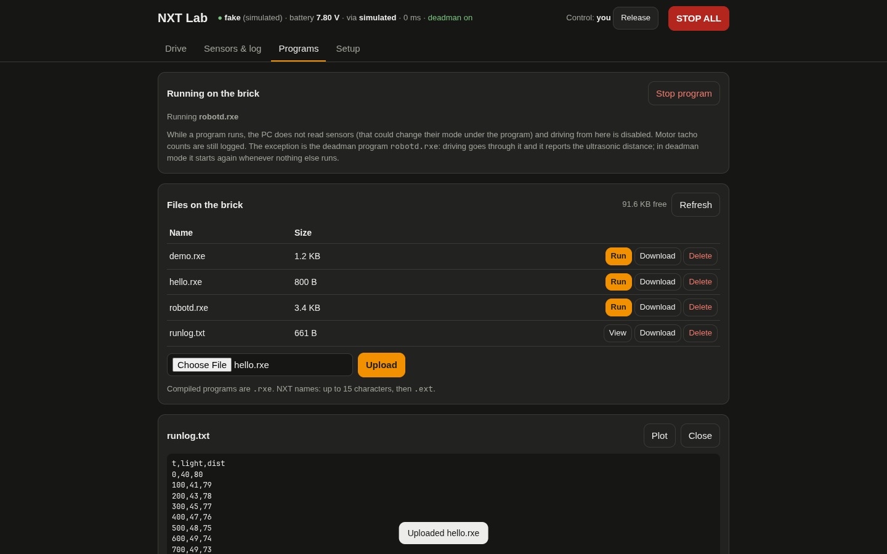
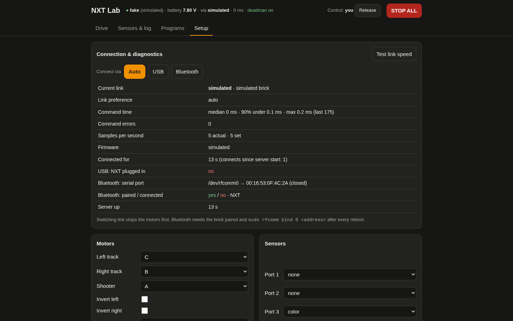
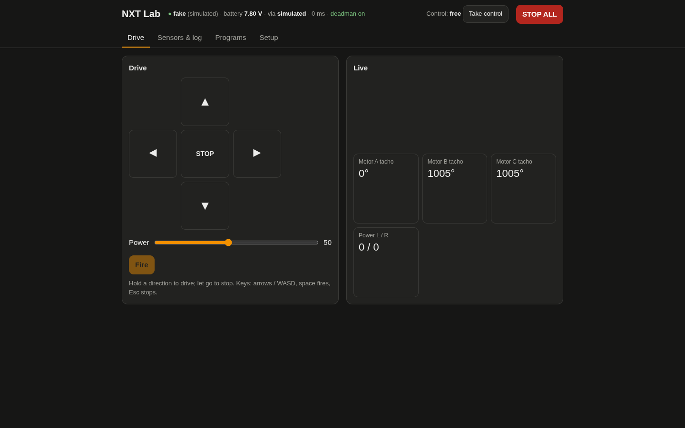

# NXT web: drive and debug the NXT from a browser

**Provisional guide.** Written from the code and from running the steps below against the
simulated brick. It has not been checked on a real brick; see [Limits](#8-limits-of-this-provisional-guide).

## 1. Purpose

`apps/nxt-web` ("NXT Lab") is a small web page and server for one LEGO Mindstorms NXT brick on
stock firmware. It is the place where a person meets the robot: drive it by hand, watch its
sensors, record what it does, and put programs on the brick
([RFC-0001](../rfc/RFC-0001-nxt-web-ui.md)).

**How it relates to Mission Control.** nxt-web is a direct drive and debug tool, and it also
sits under Mission Control:

- Standing alone, you open its page and drive. No Mission Control is needed.
- It is the only process that talks to the brick's USB or Bluetooth link, so it is the NXT's
  gate: its control lock, its STOP and its takeover list.
- Mission Control reaches the NXT only through nxt-web's HTTP API, through its NXT adapter
  (`apps/mission-control/src/mission_control/nxt.py`). The adapter uses `/api/status`,
  `/api/lock`, `/api/drive` and `/api/stop`, and keeps no second copy of the lock
  ([RFC-0014](../rfc/RFC-0014-mission-control.md), [RFC-0017](../rfc/RFC-0017-robot-access.md)).
- One controller at a time: while Mission Control holds the lock, the page shows who holds it and
  its drive buttons are off. STOP is always open to everyone.

## 2. Key use cases

- Check that a brick works: battery, link, motors turn the right way, sensors read sensibly.
- Drive it by hand from a desktop or a phone browser.
- Record a run (motors, tacho counts, sensors, command log) and replay it as a chart, a CSV, or
  an Observatory run that opens in Rerun and Lichtblick.
- Upload a compiled NXC program (`.rxe`) to the brick, run it, and read the log it wrote.
- Set which port is the left track, the right track and the shooter, and what sensor is on each
  port.

## 3. Concepts

- **The brick:** the NXT 2.0 on stock firmware. Shooterbot as checked: motors A shooter, B right
  track, C left track; colour sensor on port 3, ultrasonic on port 4.
- **NXC programs:** C-like programs in `apps/nxt-web/programs/`, compiled to `.rxe` by `nbc` in
  Docker (`scripts/nxc.sh programs/first.nxc` from `apps/nxt-web/`, or `make nxt-programs` for
  all). They run on the brick itself.
- **The simulated brick:** `--fake` gives made-up readings and moves nothing. `--sim` with a
  `--world` scene file also integrates motion and reads the ultrasonic from the world.
- **The deadman and STOP:** the page resends the drive command every 200 ms while a direction
  is held. The server stops the motors if those stop for 0.6 s. In the default "deadman" drive
  mode the brick program `robotd.rxe` also stops the tracks 0.5 s after commands stop, and
  stops forward motion under 15 cm. **STOP ALL** (header) brakes the drive motors and stops any
  running program.
- **The control lock:** a drive needs a lease (20 s, kept alive by the page). Without one the
  server refuses with "no lease, no motion".
- **USB or Bluetooth:** USB needs the udev rule in the app's README. Bluetooth needs pairing and
  `sudo rfcomm bind`, and live control needs the link the whole time. Auto tries USB first.

## 4. Start it

From the repo root, once: `make nxt-sync`. Then, with no robot:

```sh
make nxt-web-fake NXT_PORT=18210        # http://127.0.0.1:18210
```

`NXT_PORT` defaults to 8000, `NXT_HOST` to `127.0.0.1`. The page has no login: keep it on
loopback and reach it from elsewhere through an ssh tunnel. Stop it with Ctrl-C.

A simulated brick driving in a world (obstacle stop fires on a real distance):

```sh
cd apps/nxt-web && uv run nxt-web --sim --world ../../scenes/apartment/scene.json --start 0 2 90
```

## 5. Walkthrough (simulated brick)

The shots come from `make screenshots-nxt`, which starts its own `nxt-web --fake` on port 18210.

1. **Open the page.** Browse to the address above. The header shows the brick (`fake`,
   simulated), battery, link, and `Control: free` with Take control. The simulated brick
   connects by itself; on a real brick a **Connect** button appears when there is no link.

    

2. **Drive.** On the Drive tab hold a direction (or arrows, WASD). The first drive takes the
   lock for you ("You have control"); Take control does the same by hand. Let go and the tracks
   stop but you keep the lock; Release gives it back. The power slider sets 10-100. Fire
   (space) turns the shooter. Esc stops.

    

3. **Read the sensors.** Sensors & log shows each port's reading, motor tacho counts and
   power, and a chart. Tick the series you want; tacho counts start hidden because they dwarf the
   sensor lines. The colour sensor and the ultrasonic are made up here.

    

4. **Record.** Start recording, drive, Stop recording. The run appears in the table: Plot it
   again, download the CSV, or the MCAP of the same run. A recording also becomes an
   Observatory run under `nxt/unmapped/` in the lab data folder.

    

5. **Programs.** Lists the files on the brick and the free space. Choose a `.rxe` file and
   Upload; Run starts a program, Stop program ends it. While a program runs, driving from the
   page is off. The simulated brick accepts any file; it runs nothing real.

    

6. **Read a log.** View opens a text or CSV file a program wrote (`runlog.txt` here); Plot
   draws it.

    

7. **Setup.** Connection and diagnostics (link, command time, errors), the motor ports, invert
   left or right, the sensor on each port (NXT analog sensors cannot be detected), samples per
   second, and optional odometry geometry. Save setup writes `config.json`. Do not click
   Auto, USB or Bluetooth in Connect via unless you mean to open that link.

    

8. **STOP.** The red STOP ALL in the header (or Esc on Drive) stops the motors and any program
   and ends your lease: the header goes back to `Control: free`.

    

## 6. With a real brick

Describing only; not run for this guide.

- Install the udev rule from the app's README and replug the brick; for Bluetooth, pair it and
  `sudo rfcomm bind 0 <address>` (lost on reboot).
- `make nxt-web` (`NXT_LINK=usb|bluetooth|auto`, default auto). Never run a script against the
  brick while nxt-web is up: two programs on one link scramble replies.
- Deadman mode needs `robotd.rxe` on the brick: `make nxt-programs`, upload
  `apps/nxt-web/build/robotd.rxe` in Programs. Without it, in direct mode a dropped link leaves
  the motors on their last command. The README says the deadman is not yet checked on the brick.
- Over Bluetooth set samples per second to 2; USB handles 5.
- Lift the robot for the first drive.

## 7. Where to go next

- [RFC-0001](../rfc/RFC-0001-nxt-web-ui.md): the design and its safety model.
- [RFC-0017](../rfc/RFC-0017-robot-access.md): the lock, STOP and takeover.
- [RFC-0014](../rfc/RFC-0014-mission-control.md): Mission Control, the NXT's adapter.
- [App README](https://github.com/chipi/robotics-lab/blob/main/apps/nxt-web/README.md):
  setup, NXC programs, known issues.

## 8. Limits of this provisional guide

- Every step was run against `--fake` only. Nothing touched USB, Bluetooth or a real brick.
- Not run: `--sim` in a world, the obstacle stop, the deadman timeout, Fire and Run (read from
  the code and README), the Docker image, Mission Control driving the NXT.
- The simulated brick's numbers are invented; real timing, range and battery will differ.
- Screenshots are dark theme, 1440 wide; the page also has a light theme and a phone layout.
