# The Observatory: replay a run and see what the robot believed against what happened

**Provisional guide.** Written from the code and from running the steps below against a fixture
run (made-up numbers, a real robot's body), on scratch ports and a scratch data folder. It has not
been checked against a run from the simulator or a real robot; see
[Limits](#7-limits-of-this-provisional-guide).

## 1. Purpose

The Observatory (`apps/observatory`, the page title still says "miniview") keeps the lab's runs
and shows them back. A run is the record of one attempt: what the robot believed about where it
was and what was around it, what it decided and why, what its sensors saw, what alarms its software
raised, and, when the run happened in a simulator, where it really was. The page puts belief next
to truth on one timeline, so you can see when the robot's picture of the world went wrong and what
it did next ([RFC-0009](../rfc/RFC-0009-miniview.md)).

It is for reading runs, not for operating robots; that is
[Mission Control](mission-control.md), which also hands you to the Observatory at the moment of an
alarm.

## 2. Key use cases

- Find a run and open it at the moment that matters: its verdict, its events, its alarms.
- See the robot's belief against the truth: where it thought it was, where it was, and the error.
- Scrub a run: step tick by tick, jump between events, play at a chosen speed.
- Read why it did something: the decision the robot recorded, the rule that fired and its numbers.
- See what the robot saw: its depth sensor from where it stood, and its own map.
- Share a moment: copy a link that opens the run at that time; export a picture or a video.

## 3. Concepts

- **Run:** one attempt by one robot in one scene, named `robot/scene/run` (`duck/room/shots1`). It
  is a file under the data folder; a run still being written is *live*, a finished one is *replay*.
- **Scene:** the place: its bounds, boxes and hazards (a drop, for instance). It holds what is
  really there.
- **Stream:** one kind of recorded data in the run (belief pose, the plan, the map grid, depth
  frames, a joint's angle), grouped by meaning: *World* (what was really there), *Body* (what the
  robot is), *Senses* (what it perceived), *Mind* (what it believed and decided). Each has an eye
  to show or hide it.
- **Belief and truth:** belief is what the robot's software estimated (drawn blue); truth is where
  the simulator says it was (drawn green). A real robot's run has no truth. The *error* is the
  distance between them.
- **Frame:** *World* is the scene's frame, where truth lives. *Map* is the robot's own frame, which
  is all a real robot has.
- **Timeline:** the run's time axis under the stage. Everything on the page follows the cursor.
  Marks on it are events (decisions, a refusal, the verdict) and alarms.
- **Alarm:** an anomaly the software recorded (minor, major, critical), with how far past its limit
  it went ([RFC-0019](../rfc/RFC-0019-anomaly-telemetry.md)).
- **Eye:** the view from the robot's depth sensor, with a text read-out of what it was doing.

## 4. Start it

From the repo root, once: `make observatory-sync`. The Observatory needs a data folder of runs.
To try it with no robot, write the fixture the screenshots use (one run with its scene, and a
second short one):

```sh
cd apps/observatory
uv run --frozen python ../../scripts/look_shots.py --fixture-data $SCRATCH/data
```

The fixture's meshes come from `robots/duck/meshes` (`make robots`); without them the body is not
drawn but the rest works. Name the data and the index (the index is a cache and lives outside the
data), then serve:

```sh
OBSERVATORY_DATA=$SCRATCH/data OBSERVATORY_INDEX=$SCRATCH/index.sqlite \
  uv run --frozen observatory serve --port 18170
```

Open `http://127.0.0.1:18170/` (it redirects to `/web/three/`). Both variables can instead live
in an installation file (`ROBOTICS_LAB_INSTALLATION`, keys `data` and `index`). The service binds
to loopback and has no login; reach it from elsewhere through a tunnel.

Add `OBSERVATORY_CONTROL=http://127.0.0.1:18160` to serve [Mission Control](mission-control.md)
at `/control/` of the same address. On the workstation, `make observatory-up` runs the service in
Docker over `/work/robotics-lab/data` (override `OBSERVATORY_DATA`, `OBSERVATORY_STATE`,
`OBSERVATORY_PORT`).

## 5. Walkthrough (fixture run)

The shots come from `make screenshots-guides GUIDE_APPS=observatory`, which writes the same
fixture and serves it on a free port.

1. **Find a run.** The first page lists scenes and their runs: kind, robot, length, verdict and
   event count. Click a run to open it. The Scene and Run pickers in the bar do the same.

    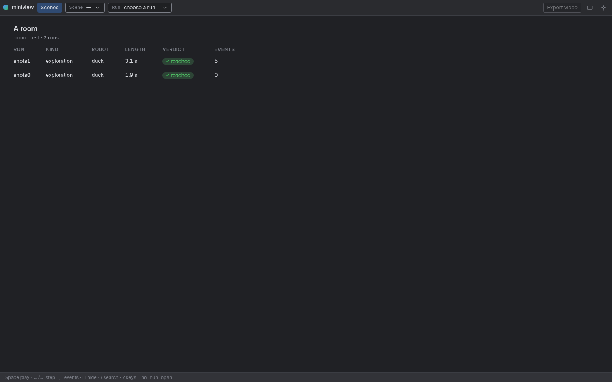

2. **Open the 3D view.** The bar has the layout (Top, Three, 3D, Eye, Chase) and the frame (World,
   Map). The stage shows the scene, the plan (yellow), the map the robot built, its obstacle
   memory, and the robot twice. Drag to orbit, wheel to zoom; *Fit robot* and *Follow* help. The
   left tree turns streams on and off. The URL records the view
   (`#scene=room&run=duck/room/shots1&view=3d&t=2.6`), so a link reopens it.

    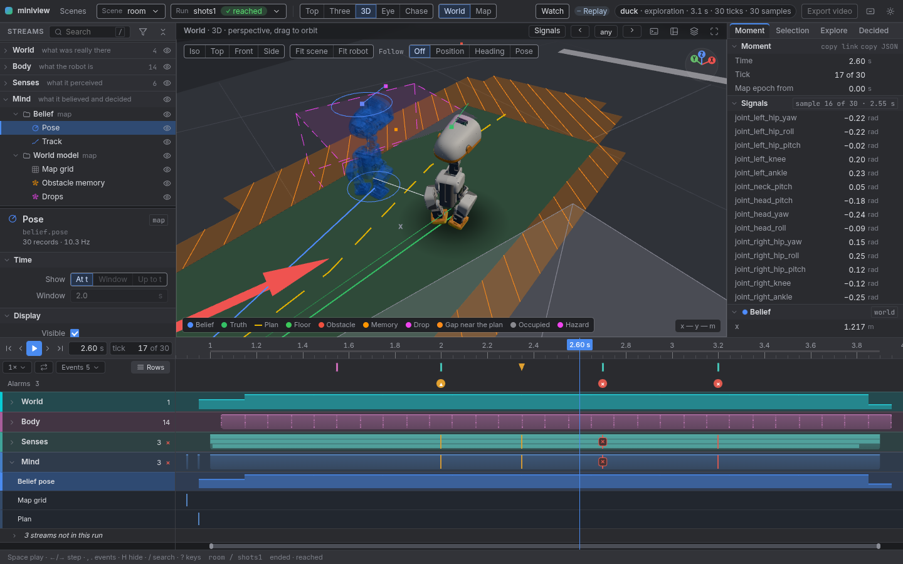

3. **Compare belief with truth.** In the Top view the blue robot is the belief and the green one
   the truth (the legend names every colour). The *Moment* tab on the right gives both poses and
   the *Error*: the distance and heading difference, and the nearest obstacle when the run has it.
   Here the fixture's belief is 0.27 m off by design.

    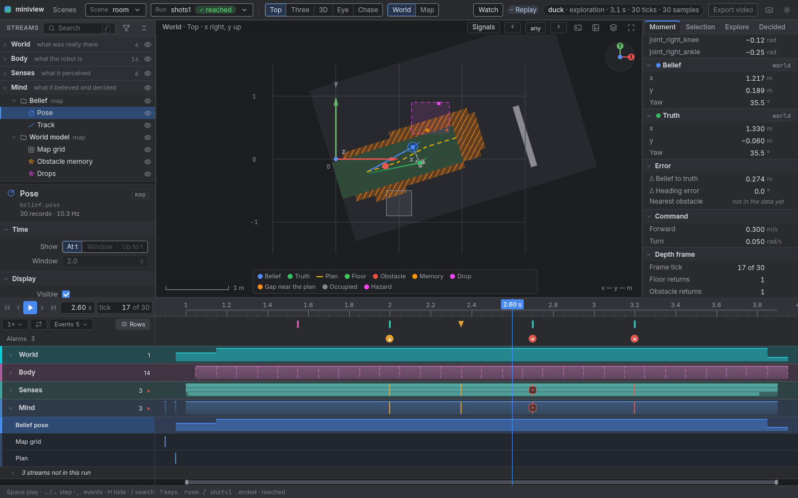

4. **Move through time.** Click or drag the ruler to put the cursor on a moment; type a time in
   the field; Space plays, the arrow keys step a tick (Shift: a second), `,` and `.` jump to the
   previous and next event, Home and End go to the ends. `1x` sets the speed and the loop button
   repeats. Every view, the Moment panel and the rows move with the cursor.

    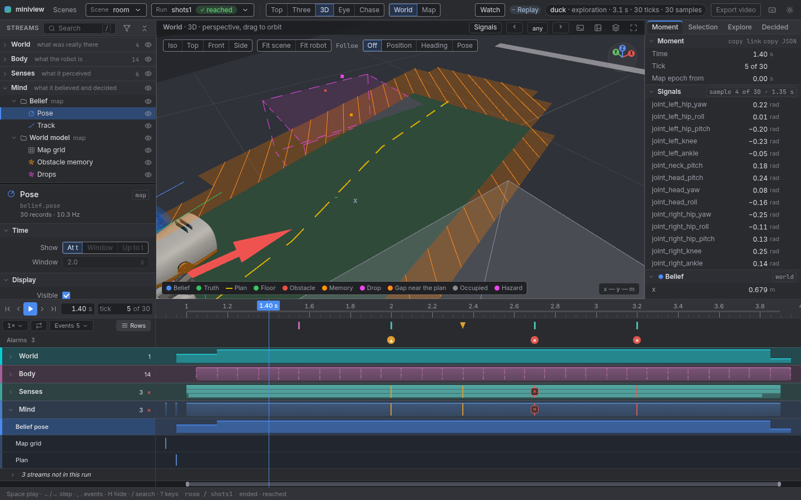

5. **Switch to the robot's own map.** Press *Map* (or `W`). The scene's truth is no longer drawn:
   the legend loses *Truth* and you see only what the robot's data says, in its own frame. This is
   the view a real robot's run gives you.

    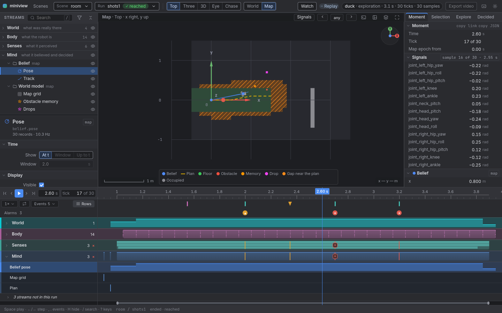

6. **Read the alarms and decisions.** Under the ruler, event marks and an *Alarms* lane show what
   happened and when; click a mark to go there and read its tooltip. The *Decided* tab lists, in
   order, what the robot decided and why: the rule, the reason and the numbers it compared
   (`refused: no room to turn`, with `room_m 0.106` and `min_room_m 0.110`), the alarms with their severity,
   and the verdict. Click a row to jump to it.

    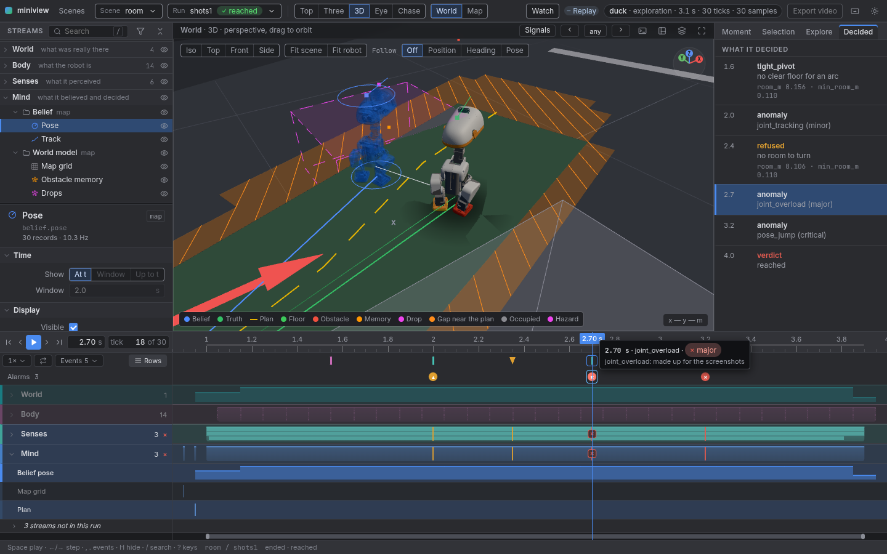

7. **See through the robot's eye.** The *Eye* layout is the view from the depth sensor, with a
   read-out (pace, what it was doing, the numbers) and the raw 8x8 depth frame as an inset. *Chase*
   sits behind and above the robot.

    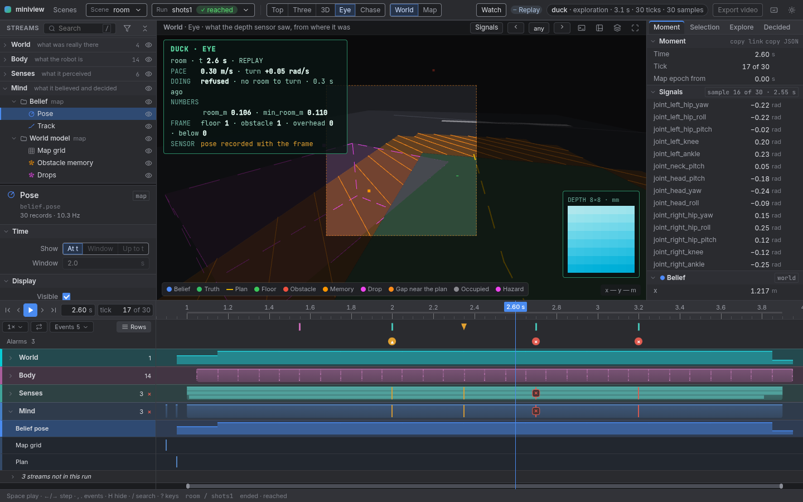

8. **Chart the signals.** *Signals* (above the stage) turns the stage into time series of the
   run's named values, here the fifteen joints. Click or drag on a chart to seek.

    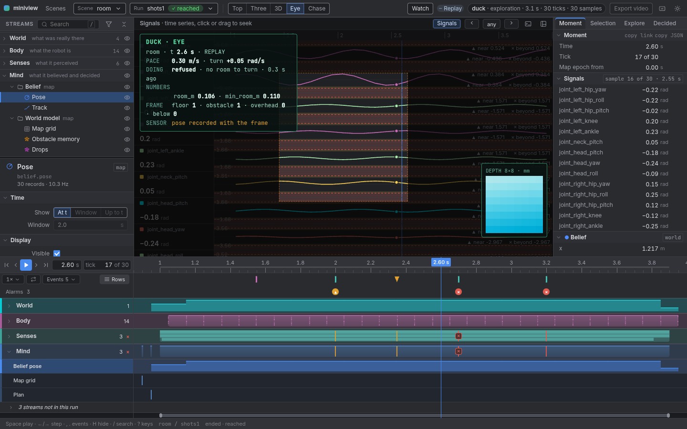

9. **Watch page.** `/watch/<robot>/<scene>/<run>` (or `.../latest`) is the eye with the top view as
   an inset and the decisions beside it, built for following a run. On a run still being written it
   follows the live edge; the *Live / Replay* badge says which. This fixture is finished, so it is
   a replay.

    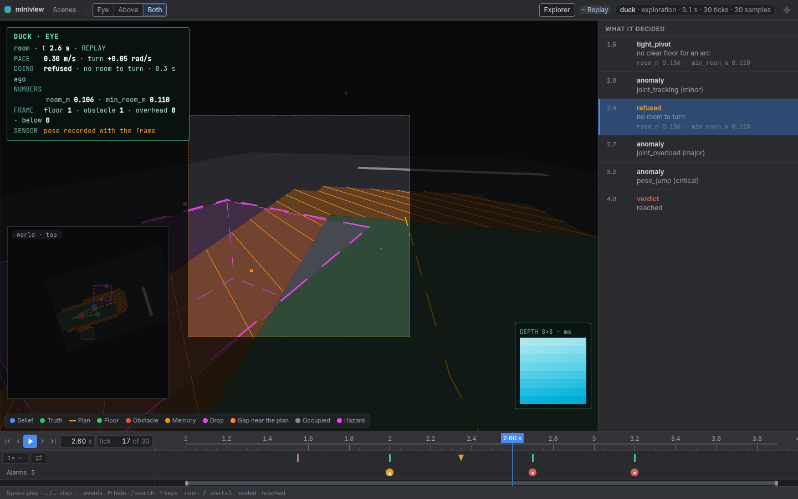

10. **Explore the body.** The *Explore* tab (or the *Explorer* link) opens the robot's model. *As
    recorded* poses it from the run's joints at the cursor; *By hand* lets you pose it. Click a part
    to see what it is. It needs the robot's meshes.

    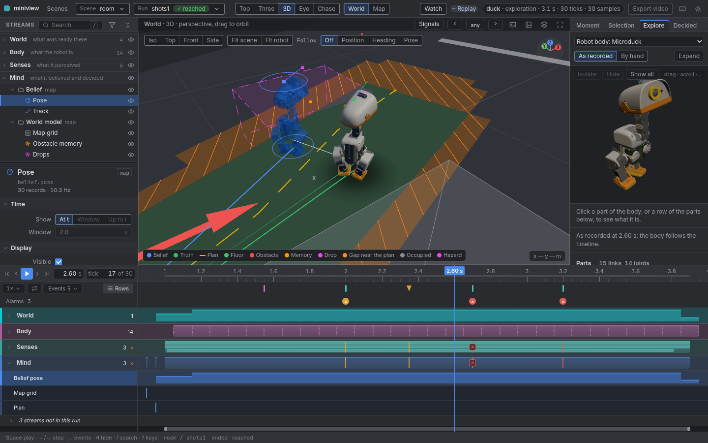

11. **Share or export a moment.** *copy link* in the Moment tab copies a URL that opens this run
    at this time; *copy JSON* copies the values. From the command line, with the same environment
    as `serve`, `observatory state shots1 --at 2.6`, `observatory events shots1` and
    `observatory frame shots1 --at 2.6 --view three -o moment.png` answer from the same data (all
    three were run on the fixture). *Export video* in the bar needs the render service
    (`make render-up`, then `OBSERVATORY_RENDER=http://127.0.0.1:8071`); it is disabled without it
    and was not run here.

12. **From Mission Control.** A goal run's *Watch* link and each alarm's *Open in the Observatory
    at this moment* open the run here at that time, when Mission Control and the Observatory share
    an address:

    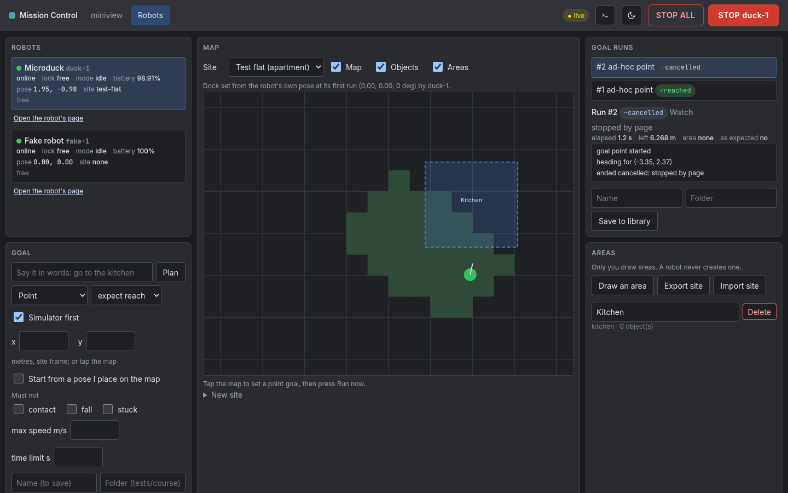

## 6. Where to go next

- [Mission Control guide](mission-control.md): the goals and STOP that produce runs.
- [Architecture](../architecture.md): where the Observatory sits.
- [RFC-0009](../rfc/RFC-0009-miniview.md) and [RFC-0010](../rfc/RFC-0010-run-store-v2.md): the
  app and how runs are stored, read and served.
- [RFC-0013](../rfc/RFC-0013-robot-eye.md): the eye and the watch page;
  [RFC-0019](../rfc/RFC-0019-anomaly-telemetry.md): alarms.
- [ADR-0007](../adr/ADR-0007-run-file-format-2.md): the run file;
  [ADR-0017](../adr/ADR-0017-video-export.md): video export.
- [UXS-001](../uxs/UXS-001-miniview.md): the page's design.
- [Observatory contract](https://github.com/chipi/robotics-lab/blob/main/apps/observatory/CONTRACT.md):
  the API, the pages and the commands.

## 7. Limits of this provisional guide

- Everything ran on the **fixture**: two short runs, made-up belief, truth, alarms and joint
  angles, a duck body from `robots/duck/meshes`. No run from the simulator or a real robot was
  opened, so real run sizes, a live (still recording) run and the live badge are read, not run.
- Not run: *Export video* and `make video` (they need the render service), the Chase view, the
  Three layout, `observatory import` of a robot's log, `repair`, `archive`, the MCP server, the
  Docker image, the light theme and the phone layout.
- There is no compare-two-runs view that I found; the Run picker opens one run at a time.
- Not covered: the semantic-object layer (objects and rooms the robot recognised), the layouts and
  panels menus, the command palette (Ctrl+K) and the Rows controls.
- Screenshots are dark theme, 1440 wide.
