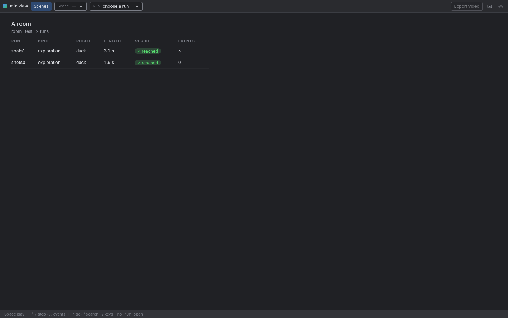
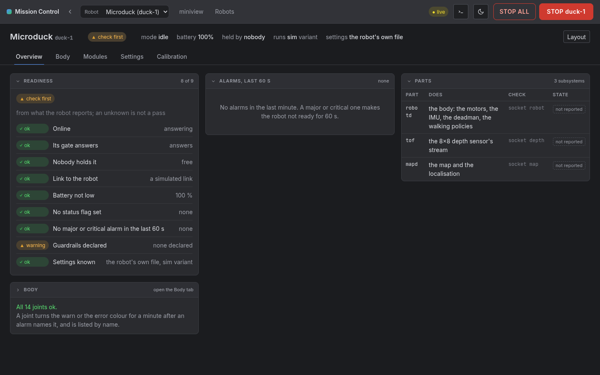

# robotics-lab

A simulator-first lab for robot autonomy. A robot brings a profile and plugins, a simulator
brings a host, a navigator is tested behind a runner that judges it by the simulator's truth,
learned controllers are trained and judged against the rules, every run is recorded one way and
watched in the Observatory, and the operator drives it all from Mission Control.

## Where things stand

- **MVP 1 is built:** the platform, both apps, the simulated duck and the NXT's simulator behind
  one control panel, and the staging stack. What is left of it is the close-out (docs, name and
  branding), the NXT at the brick and the staging cut-over.
- **The learning arc** runs before MVP 2: a learned obstacle-avoidance controller for the duck,
  trained in the public [chipi/microduck-nav](https://github.com/chipi/microduck-nav) and judged
  against our rules on frozen scenarios in a private eval repository.
- **MVP 2:** the TurtleBot3 Burger with ROS 2 and Gazebo ([RFC-0025](rfc/RFC-0025-mvp1-to-mvp2.md)).

[The handover](wip/HANDOVER.md) is the living status.

## Where to start

- **Using the apps:** [User guides](guides/index.md) for Mission Control, the Observatory, the NXT
  web app and the command line.
- **How the pieces fit:** [How the platform fits together](architecture.md).
- **Where do things stand?** [The handover](wip/HANDOVER.md);
  [the learning arc's handover](wip/HANDOVER-TRAINING-2026-11-26.md);
  [the phase 5 plan](wip/PHASE5-NEXT-PLAN.md) has the items and the wrap-up order;
  [the plan we execute on](wip/EXECUTION-PLAN.md) is the plan as written, with each phase's history.
- **How the duck learns to steer around obstacles:** [Training the controller](training/index.md), a
  guide from first principles.
- **Proposals:** [Proposals (RFC)](rfc/README.md).
- **Accepted decisions:** [Decisions (ADR)](adr/README.md).
- **Ideas and notes:** [In progress](wip/README.md).
- **How it got here:** [History](history/README.md).

## The two apps

The Observatory (once called miniview) opens every run, live or replayed: the robot's own belief
against the simulator's truth, its map, its plan, the alarms. Mission Control is the control panel:
robots, readiness, sites, goals, and STOP.

The screenshots are taken by `make screenshots` from a fixture run and the fake robot, with no
simulator and no robot.

## Projects in this repo

| Folder | What |
| --- | --- |
| [`apps/observatory/`](https://github.com/chipi/robotics-lab/tree/main/apps/observatory) | The Observatory: every run, live and replayed |
| [`apps/mission-control/`](https://github.com/chipi/robotics-lab/tree/main/apps/mission-control) | Mission Control: robots, sites, goals, STOP |
| [`apps/nxt-web/`](https://github.com/chipi/robotics-lab/tree/main/apps/nxt-web) | The NXT: Python control, web UI, NXC programs for the brick |
| [`libs/simhost/`](https://github.com/chipi/robotics-lab/tree/main/libs/simhost) | The simulator host: the host file, the reset, the truth sampler |
| [`libs/runner/`](https://github.com/chipi/robotics-lab/tree/main/libs/runner) | The runner: starts a navigator as a payload, judges it by the truth, writes the official run |
| [`libs/runfile/`](https://github.com/chipi/robotics-lab/tree/main/libs/runfile) | The run format |
| [`libs/gate/`](https://github.com/chipi/robotics-lab/tree/main/libs/gate) | The robot gate: one driver per robot |
| [`libs/missions/`](https://github.com/chipi/robotics-lab/tree/main/libs/missions) | Mission planning: goal schemas, the guardrail vocabulary, the planner; no robot |
| [`libs/worldmodel/`](https://github.com/chipi/robotics-lab/tree/main/libs/worldmodel) | Objects, the semantic map, sites |
| [`libs/web/`](https://github.com/chipi/robotics-lab/tree/main/libs/web) | The web library both apps share: tokens, fonts, the 3D stage, the palette |
| [`robots/`](https://github.com/chipi/robotics-lab/tree/main/robots) | Each robot: the duck's profile, plugins and navigator; the robots' descriptions and meshes |

Pollen's own code (the Microduck's simulator and services) is not in this repository: each machine
that runs the simulator has its checkouts, named in its host file (`simhost init`,
[RFC-0021](rfc/RFC-0021-sim-host-and-payload.md) §4; [MICRODUCK.md](wip/MICRODUCK.md)).

---

Source on GitHub: [chipi/robotics-lab](https://github.com/chipi/robotics-lab).
