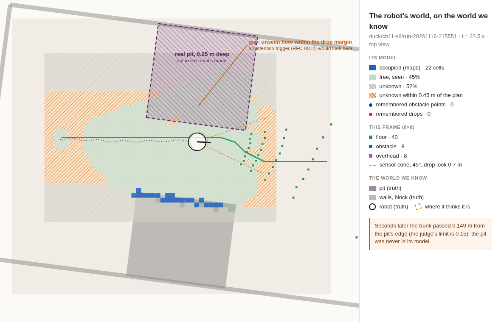
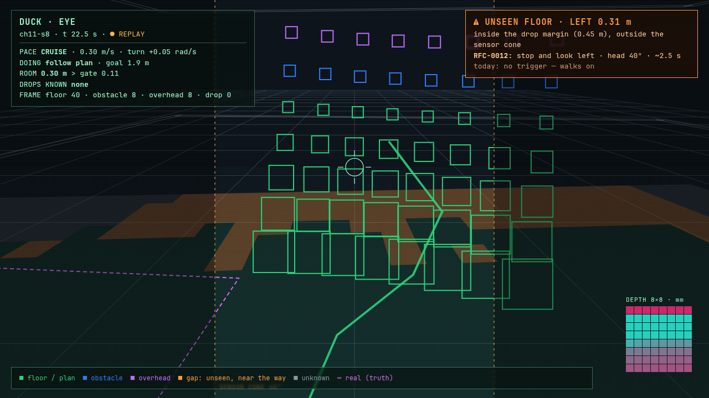
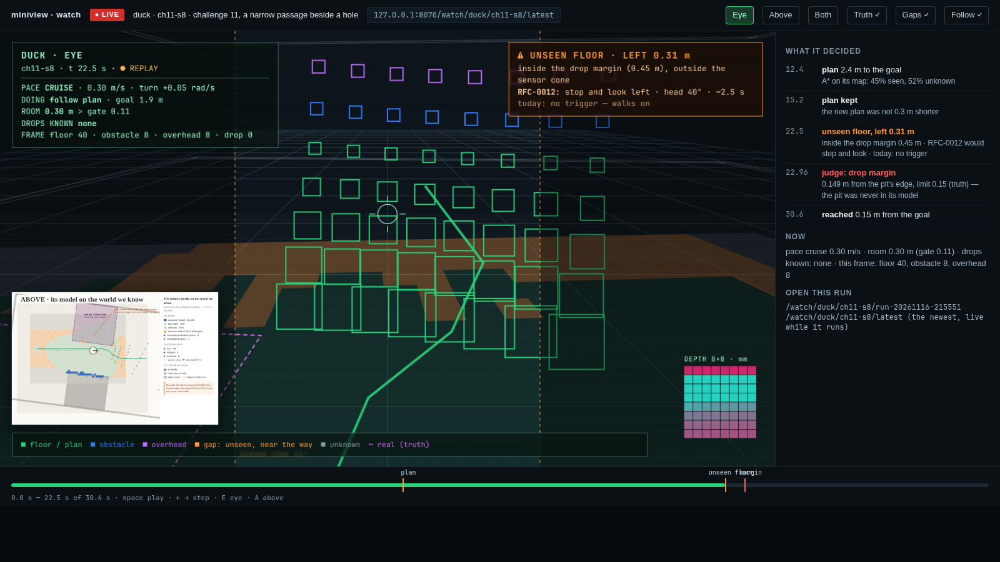

# RFC-0013 — The robot's eye: what it sees, what it builds, and a page to watch it

**Status:** Proposed (2026-11-16, the operator's direction); mockups below, prototype next
**Builds on:** [RFC-0009](RFC-0009-miniview.md) (miniview), [RFC-0010](RFC-0010-run-store-v2.md) (runs,
one API, live), [RFC-0011](RFC-0011-robot-models.md) (robots drawn as themselves),
[ADR-0014](../adr/ADR-0014-replay-logging.md) (decisions as events, frames with their state).
**Serves:** [RFC-0012](RFC-0012-look-far.md) (attention and pace: seeing why a robot looks), the challenge
course ([RFC-0008](RFC-0008-challenge-course.md): understanding a failure), and watching a robot run.

## 1. Why

The operator wants to see a run the way the robot lived it: "what the robot sees, and how it builds
its world on top of the 3D world we know", "like what RoboCop and the Terminator see", and "a URL
where I could just watch the run".

Today miniview shows a run from outside. The scene, the truth, the robot's map, its plan and its events
are all there, but nothing shows:

- what the sensor saw at a moment and how each return was classed;
- where the robot's model differs from the truth, and which of its gaps matter for the next move;
- why it did what it did, at the moment, in its own terms.

Challenge 11 seed 8 is the example: the duck passed 0.149 m from a pit that was never in its model.
Every record needed to see that is in the run. None of the views shows it.

## 2. Three things

### 2.1 Above: its model on the world we know

A top view at the playhead:

- the world we know (the scene, the truth) drawn faint underneath;
- the robot's model over it: free, occupied, unknown as fog, remembered obstacles and drops;
- the real hazards it does not know, outlined on top;
- the gaps that matter, marked: unknown ground within the drop margin of the plan (RFC-0012's first
  trigger);
- this frame's returns where they landed, the sensor's cone, the plan, the way so far;
- the robot (truth) and where it thinks it is.

As the playhead moves, the model grows over the truth: what it learned and when.

### 2.2 Eye: what it sees, first person

A camera at the sensor's recorded pose, seeing what it saw:

- the world we know as a faint wireframe, real hazards dashed;
- the robot's model on the floor: free tinted, unknown as fog, the gaps in orange, occupied cells as
  blocks;
- the 8×8 returns as squares where they hit, coloured by how they were classed (floor, obstacle,
  overhead, drop);
- outside the sensor's cone darkened, so its blind sides are plain;
- the plan on the floor;
- a HUD: pace, what it is doing, the numbers its last decision compared (room against the gate, the
  nearest known drop), this frame's counts, the 8×8 distances, and an alert when an attention trigger
  fires (or, before RFC-0012 is built, would have fired).

The HUD shows only recorded values or values computed from them; nothing is narrated.

### 2.3 Watch: one URL per run

A page for watching, not analysing:

- `/watch/<robot>/<scene>/<run>` opens one run;
- `/watch/<robot>/<scene>/latest` opens the newest, and follows it live while it is written;
- the Eye as the main view and Above as an inset (or the other way round, or both side by side);
- the decision log: each event with its rule and reason;
- a timeline with the notable events and the judge's verdict marked.

It uses the live stream and frames the API already has (RFC-0010: `/live`, `/frames`). The full explorer
stays the place for analysis, and both link to each other at the same moment.

### 2.4 One 3D scene, live and replay

The mockups are flat drawings that set the direction. The prototype is the explorer's three.js view
(the one that draws the robot's body, RFC-0011): one scene, many layers, many cameras.

- **Layers:**
  - the world we know: walls, boxes, and drops with their depth;
  - the robot's model: free, fog, gaps, remembered obstacles and drops;
  - this frame's returns and the cone;
  - the plan, the way so far, the belief against the truth.

  Each layer can be switched on and off, as the explorer's streams are today.
- **Cameras:** orbit (free), above (2.1), eye (2.2) and chase (behind and above the robot, following
  it). The same scene is seen through each one.
- **Replay and live are the same scene.** Replay reads the frames at the playhead. Live applies the
  stream as it arrives, and follow keeps the camera on the robot. The watch page (2.3) is this scene
  with chosen cameras and the decision log, without the analysis panels.

## 3. What it needs

- **Nothing new in the run files.** Each run already records the depth frames with the state they were
  paired with (the sensor's pose), the world model snapshots, the plan, the decisions with their values,
  the truth and its 3D pose (ADR-0014, ADR-0016), and the scene.
- **The cliff check's classification in the page.** Which returns were floor, obstacle or drop. Either
  the server sends the derived points (the frame records keep `derived.points`), or the page
  re-derives them with the same calibration as the run.
- **The truth's hazards in 3D.** The scene's drops have depth; the walls and boxes have height.
- **The gap rule** from RFC-0012, shared by the brain and the page, so the page marks what the robot
  would act on.
- **A camera at the sensor** in the three.js view: the sensor's pose comes from each frame's state,
  in the world frame through the run's epochs.

## 4. Order

1. The prototype of the Eye and Above on recorded runs (ch11-s8, ch10-s10, ch7-s7), behind a switch
   in the explorer, for the operator's review.
2. The watch page and its URLs, live included.
3. The HUD's attention alert, once RFC-0012's first trigger exists, so it shows what the robot did,
   not what it would have done.
4. The page tests: the Eye's camera matches the sensor's recorded pose; returns land where the cliff
   check put them; a live run is followed; and the URLs resolve.

## 5. Open questions

- The Eye's look: a dark HUD as mocked, or the explorer's light theme.
- How much of the truth to show in the Eye. Showing real hazards the robot did not see is the point
  for analysis, but it can be read as "the robot sees it". The mockups mark the truth as dashed.
- On the real duck there is no truth: the Eye then shows only what it saw and built.

## 6. Mockups

Drawn from the recording of ch11-s8 at 22.5 s with throwaway scripts (snapshot, then SVG), to set the
direction. Prototype code will be new. The decision log and the timeline marks in the watch mockup
are partly illustrative.

## 7. Discussion

- 2026-11-16, the operator: see what the robot sees and how it builds its world on top of the 3D world
  we know; RoboCop / Terminator; a URL to just watch a run; an RFC first, a few mockups before the
  prototype.
- 2026-11-16, the operator on the mockups: the decision log on the right ("What it decided") is
  exactly what was wanted; all of it to be seen in the 3D scene, live and in replay (2.4).
