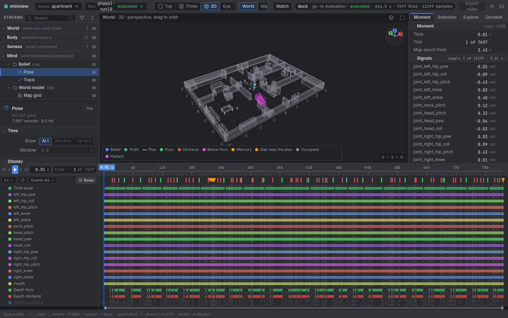
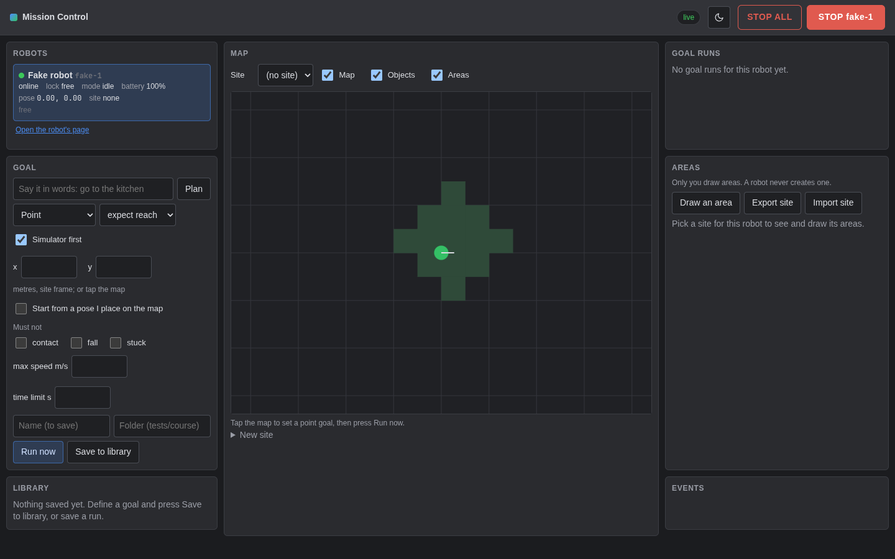

# Look and feel: independent research for both web apps

Step 4 of the MVP 1 wrap-up ([PHASE5-NEXT-PLAN](PHASE5-NEXT-PLAN.md)), 2026-11-24. Research only:
no code changed. The operator picks rows from section 4 to implement in step 4.5 (design tokens,
a design system, 3D presentation). This research is independent of any other project's notes.

**Picked for step 4.5 (the operator, 2026-11-24): all of section 4 and the five additions of
section 5a.** In groups:

- Tokens: colour semantics (rows 1 to 3), type (4, 6, 7), scales and naming (11, 14, 20, and
  uniform, colour-blind-safe ramps), one brand and top bar (24; the name itself is step 5's).
- 3D: floor and light (5, 13), camera presets (8, 16, 17), a fading trail and belief beside
  truth (5a), the model inspector (25).
- Interaction: the time model (9, 12, 15), STOP and confirm (10), evidence links (5a), signal
  views (18, 19).
- The large items, now rather than MVP 2: collapsible panels (21), the command palette (22),
  saved layouts (23), and the readiness check (5a).

How claims are marked:

- VERIFIED: I fetched the page and it says this. The URL is given.
- VERIFIED (snippet): a search result for that URL said it; I did not open the page myself.
- UNCONFIRMED: from memory or a secondary source. Treat as a lead, not a fact.

Evidence about our own apps is from the code in this worktree and from read-only GETs of the
staging stack (Observatory on 127.0.0.1:8070, Mission Control on 127.0.0.1:8060).

## 1. Where we are now

### What exists

- `libs/web/tokens.css` (60 lines) is the one shared token file, served as `/lib/tokens.css`. Both
  apps load it. `libs/web/tests/test_tokens.py` fails if the dark block, light block and the
  media-query block drift apart, or if an app declares a token itself.
- Observatory pages: `apps/observatory/web/three/index.html` (viewer, scenes, runs),
  `three/watch.html` (watch page), `web/deck/` and `web/proto/`. Styles in
  `apps/observatory/web/shell/shell.css` (460 lines). Fonts in `web/fonts/fonts.css`.
- Mission Control: `apps/mission-control/src/mission_control/web/` with `index.html`, `style.css`
  (321 lines), `app.js`, `bodyview.js`, `settings.js`.
- Shared 3D body: `libs/web/body/body.js` and `robot.js`. Three.js is vendored in `libs/web/vendor`.

### Tokens found

- Colour: surfaces `--bg-app`, `--bg-viewport`, `--bg-panel`, `--bg-header`, `--bg-field`,
  `--bg-hover`, `--bg-selected`, plus `--bg-shead`, `--bg-press`. Text `--text`, `--text-dim`,
  `--text-faint`. Lines `--border`, `--border-strong`, `--border-hover`, and five translucent
  hairlines `--hair` to `--hair-5`. Accent `--accent`, `--accent-soft`, `--on-accent`,
  `--accent-ring`. Status `--ok`, `--warn`, `--error` (three only).
- Data colours with domain names: `--c-belief`, `--c-truth`, `--c-plan`, `--c-obst`, `--c-drop`,
  `--c-floor`, `--c-ob`, `--c-over`, `--c-box`, `--c-occ`, `--c-free`, axis colours `--c-x/y/z`,
  `--c-gap`, and drawing colours `--draw-grid`, `--draw-label`, `--draw-rel`, `--draw-sel`.
- Misc: `--veil`, `--shadow`, `--scrim`, `--tip-bg`, `--range-bar`, `--range-knob`.
- Fonts: `--ui` (Inter first) and `--mono` (JetBrains Mono first).
- Dark is the default. Light via `data-theme="light"` or the system setting. Both themes are
  hand-written, three blocks, kept in sync by a test.

### Tokens absent

- No spacing scale. Gaps and paddings are literal pixels (4, 6, 8, 10, 12, 14, 16, 18, 22, 24).
- No type scale. `font-size` appears 34 times in `shell.css` and 49 times in `style.css`,
  as literal px.
- No radius scale. Observatory uses 2 to 4 px; Mission Control uses 3, 4, 6, 8 and 12 px.
- No elevation or shadow tokens (`--shadow` is a colour only; 6 and 2 `box-shadow` uses).
- No motion tokens (durations, easing). One `.12s` transition, one `pulse` keyframe.
- No size or density tokens (control heights are 22, 24, 30, 36, 40, 56 px by selector).
- No semantic roles beyond ok/warn/error: no info, no "stale", no "unknown", no "armed/safe".
- No z-index scale (20, 30 are literals).
- No 3D tokens: lights, ground, fog, camera presets, mesh colours are in JS (below).

### Inconsistencies between the two apps

1. Base type size: Observatory body is 12 px / 1.35 (`shell.css` line 8); Mission Control body is
   14 px / 1.4 (`style.css` line 8). Same operator, same origin (the Observatory proxies
   `/control/`), two densities.
2. Fonts: Observatory loads `../fonts/fonts.css` (Inter and JetBrains Mono as woff2).
   Mission Control's `index.html` loads only `/lib/tokens.css` and `web/style.css`. Its `--ui`
   stack therefore falls back to the system font unless Inter is installed on the viewer's
   machine. Same tokens, different faces. (From the HTML; not confirmed in a browser.)
3. Brand: the Observatory header says "miniview" (see screenshots); Mission Control says
   "Mission Control". The `.mark` square is the same gradient in both.
4. Control size: Observatory buttons are 22 to 24 px tall (a mouse tool). Mission Control buttons
   are 36 px (`.btn`), STOP 40 px, STOP on a phone 56 px (a touch tool). Reasonable, but nothing
   names the two densities; they are accidents of each file.
5. Chips: both define `.chip`, `.top`, `.mark`, `.grow`, `.empty` separately with different
   padding, height and radius. No shared component CSS exists in `libs/web`.
6. Hard-coded colours outside tokens: 11 hex values in `shell.css`, the green "HUD" box
   (`#bfeede`, `#5fe0a8`, `#2c8a66`, lines 426 to 459) and white-on-accent `#fff`. The Mission
   Control STOP is `#fff` on `--error`. In 3D, `build.js` and `views.js` carry a second copy of
   the palette as hex integers (`C` in `build.js`), fed from the CSS tokens by `setPalette`, but
   with fallbacks that can differ from the tokens (for example `C.fog` `0x9aa3b0`, which has no
   token).
7. Numbers: `font-variant-numeric: tabular-nums` appears once in `shell.css` (the scenes table,
   line 298) and nowhere in Mission Control. Live readouts (pose, battery, time) use `--mono`
   in places, so they are fixed-width only by luck of the font.
8. Light theme: the status colours differ per theme (good), but `--c-truth` and `--c-plan` are
   identical in both themes, so on the light viewport background the yellow `--c-plan` (#e6b400)
   is weak. (My reading of the token values; not measured for contrast.)
9. Stale and offline: Mission Control has a `live` / `reconnecting` chip (`app.js` line 1020) and
   "offline: it has not answered for N s" text per robot. The Observatory has "no run open" and a
   pulsing red `.live-dot`. Red is used for live (Observatory) and for error (both): the same
   colour means two things.

### How 3D is lit and framed today

- Observatory viewer (`web/three/app.js`, `build.js`, `views.js`): one WebGLRenderer with
  `antialias: true`, flat clear colour = `--bg-viewport` (`setClearColor`, line 237). No scene
  background texture, no fog, no ground mesh, no shadows, no tone mapping set, no environment map.
- Lights exist only when a robot body is loaded: `HemisphereLight(0xffffff, 0x444455, 1.6)` and
  one `DirectionalLight(0xffffff, 1.6)` at (1, -1, 2). Same two lines in Mission Control's
  `bodyview.js`. They do not change with the theme.
- Everything except the body is unlit: `MeshBasicMaterial`, `LineBasicMaterial`, drawn flat with
  `depthTest: false` for fills. Rooms and furniture are wireframe boxes with a faint fill.
- Ground: a metre grid made of `LineSegments` at z = 0.003, numbered along the edges with CSS2D
  labels. Axes: red x, green y, blue z arrows with labels, plus a small orbit gizmo top right.
- Camera: layouts Top, Three (a 3-pane), 3D, Eye, Chase; frames World and Map. The 3D default
  camera is a fixed position (-5.5, -7.5, 6.5) scaled by 11/9.4 looking at the origin, z up. Orbit
  by OrbitControls. No named presets beyond the view buttons; no "fit to robot" or "fit to scene".
- Body material: `MeshStandardMaterial`, roughness 0.6, metalness 0.05, colour from the robot
  description.
- Motion: `prefers-reduced-motion` is honoured in `shell.css` (line 320). Good.

### Screenshots (staging stack, read-only GETs; POSTs were blocked in the browser)

Taken at 1440x900 with the Chromium and Playwright the page tests use. In
`docs/wip/look-and-feel/`:

- `obs-viewer-dark.png`, `obs-viewer-light.png`: the runs list (76 runs).
- `obs-watch-dark.png`, `obs-watch-light.png`: the watch page with no run open.
- `obs-run-dark.png`, `obs-run-light.png`: a run (`phase1-run19`) in the 3D layout.
- `mc-overview-dark.png`, `mc-overview-light.png`: Mission Control with one fake robot.

What the screenshots show (my reading):

- The Observatory run view is dense and works: streams tree left, 3D centre, inspector right,
  a swim-lane timeline with event ticks under it. Numbers in the inspector are right-aligned mono.
- The 3D pane is a dark flat field with a wireframe apartment; nothing grounds the scene (no floor
  tint, no shadow), and the robot is not visible at t = 0.01 s.
- At 1440 px the Observatory top bar is crowded: the "Map" button is clipped and "Export video"
  wraps to two lines.
- The runs list colours every verdict word: amber for ended, trapped, stopped, no_frontier_left,
  and green only for evaluated. Most rows are amber, so amber stops meaning "look at this".
- Mission Control is a 3-column card layout. STOP ALL (outlined red) and STOP (solid red) sit top
  right, always visible. Its map is a green cell cluster on a grid; the page is calm.
- The two apps look like cousins: same palette, but different type size, button size and radius.

## 2. Arenas

Each entry: what it does well for our case, and the source.

### Robotics consoles and visualisers

- Foxglove. 3D panel has follow modes: "Pose", "Heading" (level horizon, follows position and
  yaw) and "Position"; a 3D perspective and a 2D bird's-eye toggle; custom grid layers with size,
  divisions and colour; background colour setting; URDF in visual, collision or auto display with
  opacity. VERIFIED: <https://docs.foxglove.dev/docs/visualization/panels/3d>. Layouts are
  reusable workspaces that sync and can be shared with a team; playback settings are saved in a
  layout. VERIFIED: <https://docs.foxglove.dev/docs/visualization/layouts>. The new 3D panel moved
  settings into a collapsible sidebar "to maximize scene visibility" and improved transparent
  object rendering. VERIFIED: <https://foxglove.dev/blog/announcing-foxgloves-new-3d-panel>.
- Rerun. A time panel controls "what point in time you're looking at on which timeline"; a
  blueprint decides which views show; a selection panel edits properties; a command palette on
  Ctrl/Cmd+K. VERIFIED: <https://rerun.io/docs/reference/viewer/overview>. Several user-defined
  timelines and a data-density graph in the time panel. VERIFIED (snippet):
  <https://github.com/rerun-io/rerun/blob/main/docs/content/concepts/timelines.md>.
- Lichtblick (Foxglove Studio's open fork). Same panel model, local URDF and meshes on desktop.
  VERIFIED (snippet): <https://lichtblick-suite.github.io/docs/visualization.html>. RViz was not
  researched (see section 6).
- InOrbit and Formant. InOrbit has default Fleet, Robot and Navigation dashboards; the Navigation
  one carries teleop controls and a D-pad, removed when the robot lacks the capability. Formant
  lists teleop, incident detection, root cause analysis and data replay. VERIFIED (snippet):
  <https://inorbit.ai/operations>,
  <https://www.therobotreport.com/formant-launches-cloud-based-robot-fleet-management-platform/>.
  Viam: nothing verified.
- Uber AVS / streetscape.gl. A toolkit for visualising autonomous and robotics data in the XVIZ
  protocol, built on React and Uber's WebGL frameworks. VERIFIED:
  <https://github.com/uber/streetscape.gl>. Its component list (log viewer, playback control,
  meters) was not on the pages I fetched: UNCONFIRMED.

### Mission control and space operations

- NASA Open MCT. A web mission-control framework for visualising streaming and historical
  telemetry, imagery, timelines and procedures. VERIFIED: <https://nasa.github.io/openmct/>. Its
  API has a time conductor with a Fixed mode (set bounds) and a Real-time mode (bounds follow the
  clock), and limit evaluators whose levels map to five colours: purple, red, orange, yellow, cyan.
  VERIFIED: <https://github.com/nasa/openmct/blob/master/API.md>. The point for us: live and
  replay are two named modes of one time control, and limit states have more than three colours.
- SpaceX-style consoles: not researched. UNCONFIRMED; no claim made.

### Drone ground stations

- QGroundControl. Fly view: a configurable instrument widget with attitude/compass, vehicle
  indicators with colour-coded status, arm/disarm, a video-or-map swap, and a view selector
  (Fly, Plan, Analyze, Setup). VERIFIED:
  <https://docs.qgroundcontrol.com/master/en/qgc-user-guide/fly_view/fly_view.html>. Critical
  actions use a slide-to-confirm slider (X cancels); emergency stop is reached through the
  Armed text. VERIFIED (snippet):
  <https://docs.qgroundcontrol.com/v4.4.3/en/qgc-user-guide/fly_view/fly_view.html>.
- DJI FlightHub 2. A real-time dashboard of device status and task progress; flight records with
  playback of path, position and camera orientation by flight time; alarm export and false-alarm
  tagging; multi-stream live view. VERIFIED (snippet):
  <https://enterprise-insights.dji.com/blog/dji-flighthub-2-a-new-era-of-cloud-based-drone-intelligence>.
- Mission Planner: not researched.

### Industrial HMI (ISA-101)

- "Gray is Good": most background objects and controls in contrasting greys; colour only where
  attention is needed (alarms, abnormal states); so any colour on screen demands attention.
  VERIFIED: <https://control.com/technical-articles/going-gray/>.
- Bright colour for abnormal situations, not normal; a grey background with muted colours to
  reduce glare in a bright control room; a Level 1 background near #B0B0B0 to #C8C8C8 at 0 to 5
  percent saturation. VERIFIED (snippet, secondary site):
  <https://industrialmonitordirect.com/blogs/knowledgebase/isa-101-high-performance-hmi-design-principles-color-strategy>.
- ISA's own page lists scope (menu hierarchies, navigation, graphics and colour conventions,
  alarming conventions) but not the rules; the standard itself is paywalled and I did not read it.
  VERIFIED:
  <https://www.isa.org/standards-and-publications/isa-standards/isa-standards-committees/isa101>.

### Motorsport telemetry

- MoTeC i2 Pro: cursor and zoom linking across graphs; overlay of laps with a way to slide one
  into alignment; a track map where a click moves the data cursor and the graph cursor moves the
  map dot; the map rescales to the zoomed range. VERIFIED (snippet): <https://www.motec.com.au/i2/>
  and <https://forum.motec.com.au/viewtopic.php?p=14588>. Atlas (McLaren): not researched.

### Observability

- Grafana thresholds: a Base colour (default green) and steps (default red at 80); they colour
  stat text or background, gauge, and time-series lines, regions or grid; shown as lines, dashed
  lines or regions. VERIFIED:
  <https://grafana.com/docs/grafana/latest/panels-visualizations/configure-thresholds/>.
- Grafana state timeline: coloured bars for state over time, length = duration; pan, drag-zoom,
  double-click to zoom out. VERIFIED:
  <https://grafana.com/docs/grafana/latest/panels-visualizations/visualizations/state-timeline/>.
- Grafana Saga design system: new light and dark palettes with "deeper and more opinionated
  grays", a Compact density level so many panels fit one screen. VERIFIED (snippet):
  <https://grafana.com/blog/2023/11/07/saga-design-system-shaping-the-future-of-user-experiences-at-grafana-labs>.
- Honeycomb: BubbleUp compares a selected area of a heatmap with the baseline; the trace waterfall
  shows spans, durations and which contain errors, with a minigraph of the span against peers.
  VERIFIED (snippet): <https://docs.honeycomb.io/reference/honeycomb-ui/query/trace-waterfall>.
- Datadog: not researched.

### Replay and spectator tools

- Dota 2 replays bookmark kills, deaths, tower kills and more on a timeline, and the DVR is a
  scrubber that jumps to any game time; Overwatch tags every elimination on the timeline;
  a League of Legends replay viewer interpolates positions from timeline data under a slider.
  VERIFIED (snippet):
  <https://pcgamer.com/dota-2s-replay-tools-detailed-commentaries-recommendations-and-player-cams-incoming>,
  <https://esportsinsider.com/2016/11/plays-tv-brings-replays-annotated-timeline-overwatch>.
  The point: events are marks on the scrubber, named by kind, and you jump between them.

### CAD and 3D viewers

- Sketchfab: separate settings for Scene (orientation, camera, background), Lighting (lights,
  shadows, environment), Materials, Post-processing (SSAO, bloom, DoF, AA), a ground-shadow option
  that adds a ground under a model, an environment panorama that lights the model, and a Model
  Inspector on the `i` key. VERIFIED (snippet):
  <https://sketchfab.com/blogs/community/7-essential-settings-to-make-your-uploads-look-great>.
- View cube and viewport gizmo: CAD view cubes give 26 click targets (faces, edges, corners) for
  standard views, with a dashed outline in the free orientation and solid in a preset. VERIFIED
  (snippet, Autodesk docs, not Onshape):
  <https://help.autodesk.com/cloudhelp/2024/ENU/Inventor-Help/files/GUID-4A18A2AC-69F2-44DD-AD07-B8733321E8C9.htm>.
  three.js ships `ViewHelper` (an axes gizmo for camera orientation) as an addon. VERIFIED
  (snippet): <https://threejs.org/docs/pages/ViewHelper.html>. Onshape itself: not researched.
- three.js editor: infinite-style grids with 1 unit cells and 5 unit sections, an origin marker,
  an axes gizmo. This came from an aggregate search summary, not a page I opened: UNCONFIRMED.

### Design systems for dense technical UIs

- IBM Carbon: red = danger or error, orange = serious warning, yellow = regular warning, green =
  normal or success; categorical palettes applied in sequence for neighbour contrast; in light
  themes the darkest colour is the largest value, in dark themes the lightest. VERIFIED:
  <https://carbondesignsystem.com/data-visualization/color-palettes/>.
- Radix Colors: a 12-step scale with fixed jobs: 1-2 app and subtle backgrounds, 3-5 component
  background (normal, hover, pressed), 6-8 borders (subtle, interactive, focus ring), 9-10 solid
  (pure, hover), 11-12 text (low, high contrast with guaranteed APCA contrast on step 2).
  VERIFIED: <https://radix-ui.com/colors/docs/palette-composition/understanding-the-scale>.
- Atlassian tokens: names read `color.<property>.<role>.<emphasis>.<state>`, for example
  `color.background.accent.purple.subtlest` to `.bold`; base tokens are aliased by semantic ones
  (a purple 800 becomes `color.text.discovery`); form input tokens exist. VERIFIED (snippet):
  <https://atlassian.design/foundations/tokens/design-tokens/>.

### Typography for numbers

- `font-variant-numeric: tabular-nums` makes all figures the same width so columns line up
  (OpenType `tnum`). VERIFIED:
  <https://developer.mozilla.org/en-US/docs/Web/CSS/font-variant-numeric>.
- Inter supports `tnum`, slashed zero and `calt` (the last on by default). VERIFIED:
  <https://rsms.me/inter/>. JetBrains Mono is fixed-width by design: UNCONFIRMED here (memory).

### Stale and offline data

- Per-value freshness beats a single connection flag: grey the value, show "last updated N ago",
  dim the widget, block actions that need fresh data. VERIFIED (snippet, blog posts, so
  secondary):
  <https://dev.to/atlasscada/the-dashboard-said-everything-was-fine-a-field-lesson-in-honest-data-3nf1>
  and <https://thenewstack.io/can-you-trust-your-dashboard-the-critical-role-of-data-freshness/>.

## 3. Patterns across arenas

1. Colour means state, and only state. ISA-101 greys the chrome and keeps colour for abnormal.
   Open MCT, Carbon and Grafana all map a short ordered ladder of levels to colours. Our verdict
   words in amber everywhere break this.
2. A ladder longer than ok/warn/error. Open MCT has five limit colours; Carbon has four named
   levels. We have three, and no neutral "unknown / stale".
3. Surface scales with fixed jobs (Radix 12 steps, Atlassian roles). We have the jobs (bg-app,
   panel, field, hover, selected) but under ad hoc names and without a rule for new ones.
4. Numbers are tabular, units are dimmer than values, and columns right-align. We do this in
   the Observatory inspector by mono luck, not by rule.
5. Dark is the default for operations and analysis (Grafana, Foxglove, Rerun, MoTeC use dark
   themes in what I saw; UNCONFIRMED for MoTeC). ISA-101 prefers grey for bright rooms. Both a
   dark and a light theme are expected; we already ship both.
6. Density is a setting, not an accident: Grafana Saga has Compact; Observatory-like tools sit at
   12 px, ops consoles at 14 px or more. We have both and no name for them.
7. Timeline: one scrubber that carries named event marks (Dota, Overwatch), a track per signal
   or entity with a density strip (Rerun), state bars with duration (Grafana), a cursor linked
   to the map (MoTeC), and an explicit live vs fixed mode (Open MCT). We have lanes and ticks;
   we lack a named Live/Replay mode switch with a "return to live" control.
8. 3D framing: a grid and an origin, an axes gizmo, standard view presets (cube or buttons),
   follow modes (Foxglove), a ground plane or ground shadow (Sketchfab), an environment for
   light (Sketchfab), a bird's-eye toggle. We have grid, axes, an orbit gizmo, five layouts;
   we lack ground, shadow, environment, named camera presets and follow.
9. Dangerous actions: a persistent, high-contrast STOP; a slide or two-step confirm for the rest
   (QGC). Our STOP is one tap by design; the research agrees that stopping must stay easy and
   that other dangerous actions get the friction instead.
10. Honest staleness: dim, label the age, block dependent actions (secondary sources).
11. Panels you can hide, to give the scene room (Foxglove sidebar, Rerun show/hide, our `H`).
12. Motion is rare: pulse for live, nothing else; honour reduced-motion.

## 4. Worth stealing, ranked

Effort: S under a day, M a few days, L a week or more. Row numbers are used in section 5.

| rank | idea | from | why it fits us | effort | touches |
| --- | --- | --- | --- | --- | --- |
| 1 | Colour only for state; neutral chrome | ISA-101 | Amber verdicts blur | M | tokens |
| 2 | Longer status ladder, neutral stale | Open MCT, Carbon | Only ok/warn/error | S | tokens |
| 3 | Per-value freshness: dim, age label | stale posts | Robots go offline | M | design system |
| 4 | One type scale, two named densities | Grafana Saga | 12 vs 14 px split | M | tokens, DS |
| 5 | Ground plane, soft shadow, neutral floor | Sketchfab | Scene floats on flat dark | M | 3D |
| 6 | Tabular figures on live numbers | MDN, Inter | Digits jitter while scrubbing | S | tokens |
| 7 | Load Inter in Mission Control too | own code | Same tokens, different face | S | tokens |
| 8 | Named camera presets and fit-to-robot | CAD view cube | Orbit only; hard to compare | M | 3D |
| 9 | Live vs Replay as a named time mode | Open MCT | Watch page vs viewer | M | DS |
| 10 | STOP stays one tap; other danger: confirm | QGC | Matches our STOP rule | S | DS |
| 11 | Surface and border scale, fixed jobs | Radix | Names for hair, strong, press | M | tokens |
| 12 | Event marks by kind on the scrubber | Dota, Overwatch | We have ticks; add kinds | M | DS |
| 13 | Theme-aware lighting and environment | Sketchfab | Lights ignore dark/light | M | 3D |
| 14 | Token naming: property.role.emphasis | Atlassian | Rename without breaking | M | tokens |
| 15 | Linked cursor: scrubber moves the map | MoTeC | Not checked in ours; verify | S | DS |
| 16 | Follow modes: pose, heading, position | Foxglove | Chase exists; add heading | M | 3D |
| 17 | Axes gizmo that also snaps views | three.js | Gizmo exists; click to snap | S | 3D |
| 18 | Threshold bands on signals | Grafana | Show limits on lane plots | M | DS |
| 19 | State-duration bars for modes and locks | Grafana | Drive lock, mode over time | M | DS |
| 20 | Spacing, radius, elevation, motion scales | Carbon | None exist today | M | tokens |
| 21 | Collapsible side panels for scene room | Foxglove | Streams tree eats width | S | DS |
| 22 | Command palette | Rerun | Many pages; `/` search exists | L | DS |
| 23 | Saved, shareable layouts | Foxglove | Per-operator panel setups | L | DS |
| 24 | Unify brand and top bar | own code | miniview vs Mission Control | S | DS |
| 25 | Model inspector: part list, `i` key | Sketchfab | Debug a robot mesh | M | 3D |

Notes on specific rows:

- Row 1 and 2: the ISA-101 rule is verified; the exact grey values come from a secondary
  site. We do not need to match them.
- Row 3: the rule is from blog posts, not a standard. We already show "offline: not answered for
  N s"; the gap is dimming the values and blocking actions.
- Row 5: ground shadow is verified for Sketchfab only. Whether it suits an unlit wireframe
  scene is a design decision to test, not a fact.
- Row 7: from the HTML only; check in a browser before counting it a defect.
- Row 10: QGC's slider is for takeoff, land and RTL; emergency stop is behind a slider too.
  For us STOP must not get friction; this row keeps that.

## 5. Proposal

### Token set sketch (names and roles; no final values)

Keep the existing names working through aliases, so pages do not break.

- Surfaces (row 11): `--surface-0` app, `--surface-1` viewport, `--surface-2` panel,
  `--surface-3` header, `--surface-field`; interaction `--surface-hover`, `--surface-press`,
  `--surface-selected`. Existing `--bg-*` become aliases.
- Lines (row 11): `--line-subtle`, `--line`, `--line-strong`, `--line-focus`; overlays
  `--veil-1..3`.
- Text: `--text-1` value, `--text-2` label, `--text-3` hint, `--text-on-solid`.
- Status ladder (rows 1, 2): `--status-ok`, `--status-info`, `--status-warn`, `--status-alert`
  (orange), `--status-error`, `--status-unknown` (grey), `--status-stale` (dimmed text plus
  hatch); each with `-soft` background and `-on` text.
- Action colour: `--accent`, `--accent-soft`, `--accent-ring`; and `--danger-solid` for STOP only.
  STOP does not reuse `--status-error`, so the stop button and an error text can differ.
- Data colours (the `--c-*` family): keep, but name by role (`--data-belief`, `--data-truth`,
  `--data-plan`), and add a rule: data colours never carry status.
- Axis colours `--axis-x/y/z` shared by CSS and 3D.
- Type (rows 4, 6, 14): `--font-ui`, `--font-mono`; sizes `--fs-1..5` (11, 12, 14, 16, 20 as a
  start); `--lh-tight`, `--lh-body`; a `--num` utility that sets tabular figures.
- Density (row 4): `--ctl-h-compact` (24), `--ctl-h-regular` (36), `--ctl-h-touch` (56);
  `data-density="compact|regular"` on the root, Observatory compact, Mission Control regular.
- Space and shape (row 20): `--sp-1..8` on a 4 px base; `--radius-1..3`; `--elev-0..3`;
  `--z-popover`, `--z-stop`.
- Motion (row 20): `--dur-fast`, `--dur-base`, `--ease`; all collapse to 0 under reduced motion.
- 3D (rows 5, 13): `--scene-bg`, `--scene-floor`, `--scene-grid`, `--scene-grid-major`,
  `--scene-light-sky`, `--scene-light-ground`, `--scene-sun`, `--scene-shadow`; read by
  `setPalette` so JS stops carrying a second palette.
- Test: extend `libs/web/tests/test_tokens.py` to fail on a hex colour in an app stylesheet
  (this catches the HUD box).

Design system, a small first set in `libs/web` (rows 3, 9, 10, 21, 24): top bar and brand mark,
chip, status badge (with stale state), button (three sizes), segmented control, panel and card,
table with tabular numbers, event row, time control with a Live/Replay switch, empty state.

### 3D presentation proposal

Tied to rows 5, 8, 13, 16, 17, 25.

- Ground (row 5): a floor plane at z = 0 in `--scene-floor`, slightly lighter or darker than the
  background by theme; the metre grid sits on it, with major lines every 5 m. Fade the grid
  with distance so the scene has no hard edge.
- Shadow (row 5): one soft contact shadow under the robot, not a full shadow map. Wireframe rooms
  stay unlit. Test in a screenshot before keeping it.
- Lighting (row 13): replace the fixed hemisphere plus sun with theme-driven values: a cooler
  sky and darker ground in dark, brighter in light. A neutral environment map is optional.
  Also set tone mapping and output colour space explicitly, so colours in 3D match CSS tokens.
- Materials (row 13): robot body keeps `MeshStandardMaterial`, but roughness and metalness come
  from one place, and an "x-ray" mode (Foxglove's opacity setting is the precedent) shows
  the body over the map. Map and plan layers stay flat and unlit, with status colours from
  the ladder only for faults.
- Camera presets (rows 8, 17): named presets Iso, Top, Front, Side, Follow, Eye, plus
  "fit to scene" and "fit to robot". The axes gizmo becomes clickable to snap to the nearest
  preset. Smooth the move over `--dur-base`, none under reduced motion.
- Follow (row 16): Off, Position, Heading, Pose, as in Foxglove's panel.
- Inspector (row 25): a part list for the body, one key to toggle.
- Labels: grid numbers and axis letters use the token mono font with tabular figures and a halo
  in the viewport colour so they read on both themes.
- Mission Control's body view uses the same module, so one change serves both apps.

Not proposed: bloom, SSAO, depth of field. They cost frame time and hide the data.

## 5a. Compared with Recce's research (read after sections 1 to 5 were written)

Recce's pass (its `docs/wip/research-ux-inspiration-2026-11-24.md`, 2026-11-24) looked at
creative 3D tools, capture apps, explanatory work and AI-native UX, for a reconstruction
viewer. This pass looked at operations consoles. Read side by side:

| Recce's pattern (its rank) | Here | Verdict for us |
| --- | --- | --- |
| One time cursor drives every panel; plural timelines (1) | rows 9, 15 | Agree; both reached Rerun and Foxglove. Plural timelines fit a run (wall time, tick, epoch) |
| Every claim has a handle to its evidence (3) | none | New for us: an anomaly or verdict line jumps to its time and frames the robot there |
| Show hidden state; concrete to abstract (4) | none | Fits belief vs truth: draw the belief beside the truth by default, not as an option |
| Analysis as overlays, one toggle each (6) | rows 18, 21 | Agree; our layers already toggle, add the legend |
| Perceptually uniform ramps; a three-input theme (7) | rows 1, 14 | Add: ramps (maps, costs, coverage) in a uniform space with a colour-blind variant |
| Command palette, one verb list for people and agents (9) | row 22 | Agree; the MCP of step 3 is half of the verb list already |
| Reduce Motion switch (15) | 3D section | Agree; the Observatory honours it, Mission Control is unchecked |
| Fading trail behind a moving object (16) | none | Fits the robot's path in replay: a fading trail of recent poses |
| Readiness check against named requirements (13) | none | Fits a profile or a run: "ready for a real run" with the checks named |
| Mini-labs, completion ring, node networks, tethered capture | none | Recce's own; not for an operations console |

What this pass has that Recce's does not: ISA-101 grey-first colour, stale and offline data,
STOP and dangerous-action affordances, tabular figures, and the density scale (rows 1 to 4, 6,
10). Neither pass watched a product in use; both rest on fetched or remembered descriptions.

## 6. Not covered

What I did not do, and what is weak.

Sources I did not fetch or could not read:

- RViz, Viam, Formant and InOrbit product pages themselves (only search snippets), SpaceX-style
  consoles, Mission Planner, Atlas (McLaren), Datadog, Onshape (I used Autodesk's view cube docs
  instead), the three.js editor source, Rerun's 3D view docs (docs.rerun.io did not resolve),
  Atlassian's own pages (snippet only), streetscape.gl component docs (the README did not list
  them), QGC's fly tools page (404).
- ISA-101 itself (paywalled). Grey-first is verified from trade articles and a vendor blog, not the
  standard. The grey values are from a secondary site.
- Game replay claims are from search snippets of press articles; I did not open those pages.
- Stale-data guidance is from blog posts, not a standard or a design system.
- "Dark is the default" in section 3 is partly from memory (Foxglove, Rerun, MoTeC): UNCONFIRMED.
- The color of three.js `AxesHelper` (x red, y green, z blue) is from memory: UNCONFIRMED.

Our own apps:

- I looked at one run (`phase1-run19`, at t = 0.01 s, the first frame), the runs list, the watch
  page without a run, and Mission Control's overview with a fake robot. I did not open: the robot
  page and its drawers, settings, calibration, the deck, the scenes page, the explore and semantic
  views, the Eye and Chase layouts, the live page, any modal, or any phone-width layout.
- The robot body was not visible in my run screenshot, so I did not see the lit body in the
  Observatory. Its lighting is read from code only.
- I did not measure contrast (no WCAG or APCA numbers), colour-blind legibility, frame time or
  GPU cost. All visual judgments here are my reading of screenshots.
- Fonts: I did not confirm in a browser whether Mission Control renders Inter or the fallback.
- The check of which hex values differ between `build.js` fallbacks and the CSS tokens was a
  read of the code, not a diff run.
- Light theme screenshots were taken but I read only the watch page one; the rest I did not view.
- I did not read the repo's RFC-0024 or any ADR on the design intent beyond the comment at the top
  of `tokens.css`; a decision there may already cover a row.
- No user testing and no operator interviews: "why it fits us" is my inference from the code and
  the docs, not from how you use the apps.
- No hands-on test of any competitor tool; everything about them is from documentation or search
  summaries.
